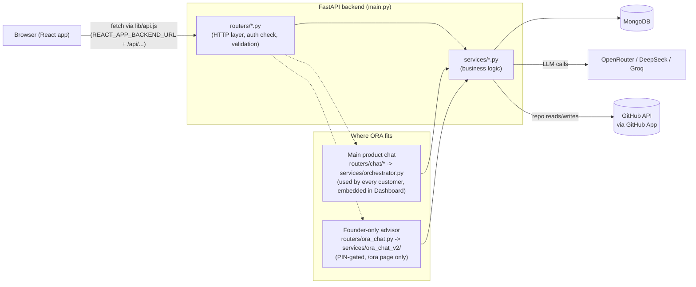
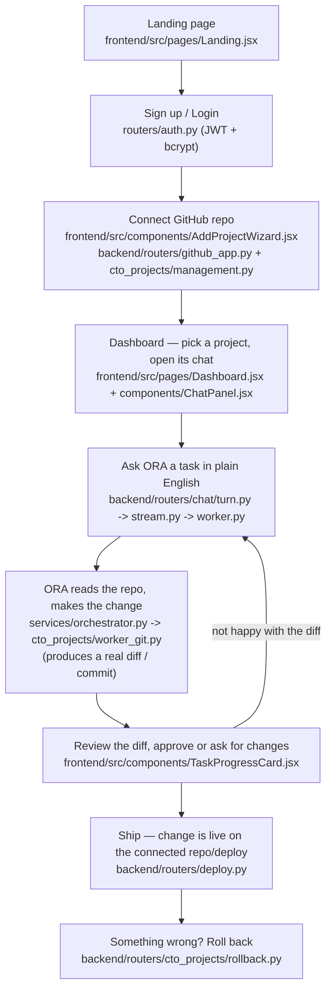

# AUREM Developer Handbook

Welcome. This is the one file you need to start fixing real bugs in this
codebase without pinging the founder every hour. Read it top to bottom once,
then keep it open as a reference.

## Table of contents

1. [What this product is](#1-what-this-product-is)
2. [Tech stack](#2-tech-stack)
3. [Folder structure map](#3-folder-structure-map)
4. [Architecture diagram](#4-architecture-diagram)
5. [User-facing flow map](#5-user-facing-flow-map)
6. [Auth & access model](#6-auth--access-model)
7. [How to run this locally](#7-how-to-run-this-locally)
8. [How to debug a bug report](#8-how-to-debug-a-bug-report)
9. [Known issues / fragile areas](#9-known-issues--fragile-areas)
10. [Who/what to ask](#10-whowhat-to-ask)

---

## 1. What this product is

AUREM is a web app where a founder or developer connects a real GitHub
repository and then just *asks*, in plain English, for something to be fixed
or built — "the signup button is broken on mobile", "add a dark mode toggle"
— instead of writing the code themselves. Under the hood an AI agent reads
the actual repo, makes the change, and shows the result as a real diff/commit
the person can review before it ships.

The customer is typically a non-technical or time-poor founder who has a
GitHub repo (often built with another AI tool, or by a past developer) but no
in-house engineer to keep fixing and shipping small things. They connect
their repo once, then keep coming back to ask for fixes the same way they'd
message a contractor.

**ORA** is the name of the AI agent/persona that does this work. There are
actually two separate ORA surfaces in this codebase, and it's important not
to confuse them:
- The **main product chat** (embedded in the Dashboard, one per connected
  project) is what every customer uses to ask for a change. It streams a
  reply, can call tools (read the repo, run a fix, open a PR-style change),
  and is the thing described in the user journey below.
- A **separate founder-only advisor chat** at `/ora` (`OraDirect.jsx` +
  `routers/ora_chat.py`) is a completely different, PIN-gated tool the
  founder uses to ask ORA about the *business* itself (funnel numbers,
  production status, "why did this test fail") — not a customer-facing
  feature. Don't assume code you find under `ora_chat.py` / `ora_chat_v2/`
  is used by regular customers — it isn't.

## 2. Tech stack

- **Frontend:** React 18 + Vite (the `REACT_APP_` env var prefix is a naming
  holdover from an earlier Create React App version — Vite is configured to
  still expose that prefix, see `frontend/vite.config.js`).
- **Backend:** FastAPI (Python), running under `uvicorn`, managed by
  `supervisor` (not started manually).
- **Database:** MongoDB (Motor async driver). No ORM — routers read/write
  plain dicts against collections directly.
- **Hosting/deploy:** Emergent platform (preview environments); production is
  `auremcto.com`.
- **AI models:** OpenRouter as the primary LLM gateway, with a fallback chain
  down to DeepSeek direct and Groq if a provider is unavailable (see
  `backend/.env.example`'s LLM section) — plus Google Gemini/GenAI SDKs for
  some specific features.
- **Payments:** Stripe.
- **Auth:** hand-rolled JWT (PyJWT) + bcrypt password hashing — not a
  third-party auth provider.
- **Object storage / infra extras:** Redis (rate limiting, with an in-memory
  fallback if Redis is down), Sentry (error tracking), AWS SDK (boto3) for
  some integrations.

## 3. Folder structure map

```
/app
├── backend/
│   ├── main.py            # FastAPI app: creates the app, registers every router, startup/shutdown
│   ├── routers/           # ~100 files — one HTTP surface each (e.g. auth.py, loop.py, deploy.py)
│   │   └── cto_projects/  # Everything about a connected project: add/list, rollback, worker, tasks
│   │   └── chat/          # The MAIN chat pipeline customers use (turn, stream, worker, watchdog)
│   ├── services/          # ~300 files — the actual business logic routers call into
│   │   └── ora_chat_v2/   # The founder-only advisor chat engine (NOT the customer chat)
│   ├── cto_services/      # Core shared services: auth.py (JWT), db.py (Mongo connection)
│   ├── config/            # Static config/constants
│   ├── core/              # Low-level shared primitives
│   ├── tests/             # pytest backend tests — real HTTP + real Mongo where practical
│   └── scripts/           # One-off/maintenance scripts (migrations, seed data, linting)
├── frontend/
│   └── src/
│       ├── pages/         # One file per route (Dashboard.jsx, Projects.jsx, Settings.jsx, ...)
│       ├── components/    # Reusable UI pieces (ChatPanel.jsx, Shell.jsx = the sidebar shell, ...)
│       ├── hooks/         # Custom React hooks (e.g. GitHub connection status polling)
│       ├── lib/           # api.js (the one Axios client every page uses), analytics, etc.
│       └── utils/         # Small pure helper functions
├── memory/                # This project's own living documentation (PRD, changelog, roadmap)
├── docs/                  # One-off investigation/RCA write-ups
└── test_reports/          # JSON reports written by the automated testing agent after each run
```

## 4. Architecture diagram

How a normal request flows through the system, and where the two ORA
surfaces sit relative to it:



## 5. User-facing flow map

The real journey a customer goes through, with the file that owns each step:



## 6. Auth & access model

- **Regular login:** email + password. Passwords are hashed with `bcrypt`
  (never stored in plaintext, never logged). A successful login returns a
  signed JWT (`cto_services/auth.py::create_token`) that the frontend stores
  in `localStorage` under the key `aurem_token` and sends as
  `Authorization: Bearer <token>` on every API call (`frontend/src/lib/api.js`).
- **Sessions:** JWTs currently expire after **7 days**. Every call to
  `GET /auth/me` re-signs a fresh token, so an active user effectively never
  gets logged out; an inactive one does after a week. Tokens carry a random
  `jti` so a specific leaked token can be revoked server-side without forcing
  everyone else to log in again.
- **The /ora PIN gate:** completely separate from the above. `/ora` (and
  `/ora/*`) is reachable with **zero** existing login — landing there always
  shows a PIN pad (`frontend/src/pages/OraDirect.jsx`) before any content
  renders. Entering the correct PIN calls `POST /ora-chat/pin-login`, which
  mints its own JWT. As of the Feb-2026 fix, PIN success is tracked by a
  *dedicated* marker (`localStorage.ora_pin_token`) — simply already having a
  normal-login token does **not** satisfy this gate anymore (that was a real
  bug: it used to let anyone already logged into the dashboard skip the PIN
  entirely). If an authenticated founder has never set a personal PIN yet,
  they're prompted to set one before anything else loads — `/ora` is never
  left reachable with no PIN configured at all.
- **Team roles & permissions (added Feb 2026):** an account owner can invite
  teammates and grant each of them, per real product area (Projects, Deploy,
  Domain, Loop/ORA-fixes, Billing, Team management, ...), one of **No
  Access / Read / Write / Full**. See `backend/services/team_permissions.py`
  for the resource list and `backend/routers/team_management.py` for the
  invite/accept/revoke endpoints. The important thing for debugging: a
  regular account owner has **no** `team_members` row at all — they're
  always full-access by construction. An invited teammate's requests get
  transparently redirected to the *owner's* data via
  `effective_account_id` — if a teammate reports "I don't see the project",
  check whether their `team_members.permissions` actually grants `read`/
  `write` on that resource, and whether the endpoint they hit has actually
  been wired through `require_permission`/`check_permission` yet (not every
  one of the ~100 routers has been retrofitted — see the RBAC section of
  `memory/PRD.md` for exactly which endpoints are covered so far).
- **Every permission check is server-side.** The frontend hides nav items
  and buttons a user can't use, purely for a clean UX — but that's cosmetic.
  If you're debugging "a button is missing", check the real gate in the
  backend router first; the frontend hiding logic is never the source of
  truth.

## 7. How to run this locally

You don't need to start anything manually in this environment — `supervisor`
already runs both processes and restarts them on crash. Useful commands:

```bash
# Check both services are up
sudo supervisorctl status

# Restart after changing a .env file or installing a new dependency
sudo supervisorctl restart backend
sudo supervisorctl restart frontend

# Tail logs live while reproducing a bug
tail -f /var/log/supervisor/backend.err.log
tail -f /var/log/supervisor/backend.out.log
```

Regular code edits (Python or React) hot-reload automatically — you do not
need to restart anything just for a code change.

**Env vars you'll need** (see `backend/.env.example` and
`frontend/.env.example` for the full, always-current list — names only, no
real values are ever committed):

- Backend: `MONGO_URL`, `DB_NAME` (database), `EMERGENT_LLM_KEY` /
  `OPENROUTER_API_KEY` / `DEEPSEEK_API_KEY` / `GROQ_API_KEY` (LLM access),
  `GITHUB_REPO`, GitHub App credentials (repo connection), `STRIPE_*`
  (billing), `RESEND_API_KEY` (transactional email).
- Frontend: `REACT_APP_BACKEND_URL` (the only one that matters day-to-day —
  every API call in the app goes through this).

Run the test suites directly when iterating on a fix:

```bash
# Backend (from /app/backend)
python -m pytest tests/test_some_file.py -v

# Frontend (from /app/frontend)
yarn vitest run src/components/__tests__/SomeFile.test.jsx
yarn lint
```

## 8. How to debug a bug report

1. **Reproduce it first.** Don't start editing code from a guess. If it's a
   UI bug, open the real preview URL (from `frontend/.env`'s
   `REACT_APP_BACKEND_URL`, the frontend itself is one origin up) and click
   through the exact steps reported.
2. **Confirm the live build.** Hit `GET /api/health` — it returns a
   `build_hash` you can compare against `git log` to make sure you're looking
   at the code that's actually running, not a stale cache.
3. **Check the logs first.**
   `tail -n 100 /var/log/supervisor/backend.err.log` for backend errors —
   most "500" bugs show a full Python traceback there pointing straight at
   the offending file/line. For frontend bugs, open the browser console.
4. **Find the owning file.** Use the folder map in section 3: a `/api/xyz`
   URL almost always maps 1:1 to `backend/routers/xyz.py` (check
   `main.py`'s `app.include_router(...)` calls if the prefix isn't obvious).
   A page bug maps to `frontend/src/pages/<PageName>.jsx`; a bug in a
   specific widget maps to `frontend/src/components/<Widget>.jsx`.
5. **Read the router function top to bottom before touching it.** Most
   handlers here follow the same shape: resolve the caller
   (`current_dev(authorization)`), fetch/validate input, hit Mongo, return a
   plain dict. Follow that same shape in your fix — don't introduce a new
   pattern for one endpoint.
6. **Write a real test before calling it fixed.** Backend: a pytest file
   under `backend/tests/` that hits the real endpoint (see any
   `test_phase1_*` or `test_phase3_*` file for the current house style — real
   HTTP against the live server, real Mongo, no mocks where avoidable).
   Frontend: a Vitest file under the relevant `__tests__/` folder.
7. **Re-check the build hash and re-run your reproduction steps** once the
   fix is in, to prove it's actually resolved — not just "should be fixed
   now".

## 9. Known issues / fragile areas

Straight talk, so you're not blindsided:

- **Two parallel chat systems exist** (`routers/chat/*` for customers,
  `ora_chat.py`/`ora_chat_v2/` for the founder-only advisor). They do **not**
  share the same reliability machinery (retry ledger, timeout clocks) — a
  fix made to one does not automatically apply to the other. Check which one
  you're actually in before assuming behavior.
- **RBAC (team permissions) is not yet wired into every router.** The
  enforcement mechanism itself (`require_permission`/`check_permission`) is
  real and server-enforced everywhere it's been applied, but only a
  representative set of endpoints have been retrofitted so far (Projects,
  GitHub connect, Loop, Deploy, Domain, Automations, Support, Billing,
  Reports, Settings, Integrations — see `memory/PRD.md` for the exact list).
  A teammate hitting an endpoint that hasn't been retrofitted yet will
  currently see their own (empty) personal data instead of the owner's
  shared data, rather than a clean 403 — that's a known gap, not a new bug.
- **The legacy GitHub PAT (personal access token) connection path is
  deprecated** — the codebase has removed support for it in the actual token
  resolution logic (`services/pat_vault.py::get_repo_token_or_error`). Some
  older tests still insert a raw plaintext token and expect the old
  behavior — those tests are stale, not a regression if they fail.
- **A handful of pre-existing test files fail on a fresh checkout** for
  reasons unrelated to whatever you're working on (a few `mcp.py` manifest
  tests, one `execute_bash` tool-refusal-message test, some flaky
  `ChatPanel`/animation-timing tests). Before assuming you broke something,
  run `git stash` and re-run the same failing test to confirm it fails
  identically without your change.
- **Two separate PIN-like concepts exist and are easy to confuse:** the
  per-account `/ora` PIN gate (section 6) and an unrelated admin feature
  called "BIN" (`routers/admin_bin.py`, `pages/AdminBINTracker.jsx`) — despite
  the similar-sounding name, "BIN" is not an authentication mechanism.
- **This app is single-owner-per-account under the hood**, with the Feb 2026
  team-permissions layer added on top without changing that core model. If
  you're touching account/ownership logic, remember most of the ~300 service
  files still assume "the caller's own `user_id` is their data" — only the
  retrofitted endpoints listed above correctly redirect a teammate to the
  owner's `effective_account_id`.
- **Known open bugs from the current backlog** (see `memory/PRD.md` "Known
  open items" for the live, up-to-date list): a code-fence input normalizer
  quirk, a semantic classifier timeout edge case, and a few production/infra
  blockers that are founder/ops actions rather than code fixes (expired
  tokens, email sender domain config).

## 10. Who/what to ask

- **This handbook + `memory/PRD.md`** are the source of truth for "what's
  been built and what's still open" — check `PRD.md` first, it's kept
  current after every round of work.
- **`memory/CHANGELOG.md`** has the dated history of what shipped when, if
  you need to understand why something is the way it is.
- **Git history** (`git log`) shows every change with a real commit message
  — use it before asking anyone "why is this like this".
- **The founder/account owner** is the actual escalation path for anything
  not answered by the above — especially product decisions (should this be
  allowed at all?) versus pure bugs (this doesn't do what it's supposed to).
- When genuinely stuck after checking logs, `git log`, and this handbook:
  write down exactly what you tried, the exact error text, and the exact
  reproduction steps before asking — it gets you an answer faster than "it's
  broken".
