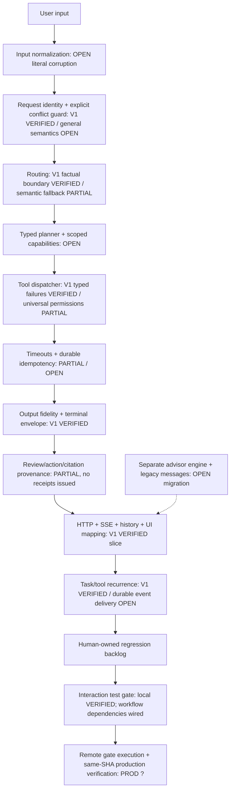

# Aurem/ORA — interaction reliability audit

Date: 2026-09-22. Baseline source: `27f428d7`. Result: **bounded opt-in safeguards verified in sandbox; NOT production-fixed and NOT a complete closure of all eight families.**

## Scope and evidence

- Initial instruction authorized structural implementation in the existing workspace. Later PDF/blueprint comparison is **read-only**; the newly observed normalizer/router design gaps below were NOT changed.
- References read: `memory/AUREM_BLUEPRINT_FROM_ZERO.md`; `memory/SYSTEM_AUDIT_2026_09_22.md`; stored architecture overview/frontend/backend mappings; subsequently the complete supplied **Coding-Agent-SaaS-Blueprint.pdf**, sections 1–17, including embedded mapping. A separate standalone Reliability Map artifact was not positively identified. Its contents are not assumed.
- Exact PDF source: https://customer-assets-v7afamib.emergentagent.net/job_1b6bb0b1-4adc-4fcf-acd0-64257fdcd80e/artifacts/yjxmgbgc_Coding-Agent-SaaS-Blueprint.pdf
- Inspected main HTTP/SSE routes, orchestration, response guards, persistence, history mapper, message controls, tool wrappers, recurrence cron and tracked release workflows. Alternate advisor entry inspected: `backend/routers/ora_chat.py:286–338` forwards to a separate v2 engine and stores a different response shape. That engine was not exhaustively traced in this round.
- No production requests, configuration changes, repository writes through connected tools, or deployments were made for verification. Preview page loads and external `/api/health` returned 200; these are availability checks only.
- `INTERACTION_CONTRACT_V1=1` activates the new behavior. It remains **absent/OFF** in preview configuration; no production activation was attempted. Semantic routing canary configuration was observed at **10%**, unchanged.
- Contract API tests use the real ASGI application with **MOCKED authentication resolution/provider-branch spies**. Tool callback tests use **MOCKED tool implementations**; persistence/recurrence tests use real isolated Mongo databases. No live paid-model replay was performed. This is not production traffic evidence.
- Source references below refer to the updated workspace; original code can be inspected with read-only `git show 27f428d7:<path>`.

## Verification ledger

| Check | Actual outcome | Evidence |
|---|---|---|
| Initial existing-path baseline | Backend 11 failed / 7 passed; frontend 3 failed | `test_reports/interaction_audit_before_backend.txt`, `interaction_audit_before_frontend.txt` |
| Final contract gate | **38 backend + 8 frontend passed** | `test_reports/interaction_audit_verified_gate.txt`, `test_reports/interaction/{backend,frontend}.xml` |
| Fail-closed negative control | Real gate script exits 23 with failed pytest executable; frontend executable not invoked | `test_interaction_gate_fail_closed_control_stops_after_first_failure` |
| Full frontend after fixes | **11 failed / 795 passed**, 152 files; NOT green | `test_reports/interaction_full_frontend_after_fix.txt` |
| Full backend configured lane | Started, multiple failures, bounded stop around 10%; NOT completed | `test_reports/interaction_full_backend_pytest.txt` |
| Frontend lint | Exit 0, full src | `test_reports/interaction_frontend_lint_final.txt` |
| New Python modules/tests/probe lint | pyflakes exit 0 | Run listed below |
| Existing Python warnings | Same 10 warnings in local_tools/stream/worker versus baseline | `test_reports/{baseline_pyflakes_27f428d7,current_pyflakes_interaction_audit}.txt` |
| GitHub workflow execution | **NOT executed/verified remotely** | Only local YAML dependency assertions and script behavior verified |
| Production behavior/deployed revision | **UNVERIFIED** | No authorized production evidence in this run |

The initial testing report identified a new malformed-action crash; it was fixed and the final gate above supersedes that report's non-zero status. Some baseline cases already passed; no claim is made that every new test failed previously. New envelope tests assert previously missing behavior; existing-path failures have actual before logs.

An archived-source rerun of the six failing frontend files at `27f428d7` reproduces the same eleven failing cases, plus one extra baseline failure: `test_reports/interaction_frontend_baseline_27f428d7.txt` (12 failed/38 passed). It uses the same installed dependencies; this is baseline comparison, not production verification.

## Gate common to all eight sections

`bash scripts/interaction_gate.sh` explicitly runs:
- `backend/tests/test_interaction_reliability_contract.py`
- `frontend/src/utils/__tests__/interactionReliability.test.jsx`

It is called by `scripts/predeploy_gate.sh:33` and `.github/workflows/interaction-reliability.yml`. `auto_deploy.yml`'s `deploy-and-report` and `deploy.yml`'s `deploy` now require the reusable workflow via `needs`. YAML tests assert these dependencies; a failed test is not converted to a warning. CI creates an isolated Mongo connection and ephemeral import-time signing secret; no provider keys are needed for these tests.

**Boundary:** the repository QA script already used `set -euo pipefail`; it was not universally ignoring failures. The gap was missing interaction-specific coverage and explicit release-job dependencies. External/manual release paths not invoking these workflows/scripts remain UNVERIFIED. The deployment notification preceding this work does not prove this code was included or gated.

## 1. Task/context substitution

**Shared locations:** `backend/services/bail_reason.py:128–155,179–188` (keyword-selected replacement reply); `routers/chat/retries.py:62–99` (replacement after confidence retries); `services/business_voice_filter.py:260–327` (chained rewrite/append passes); `services/design_refusal_guard.py:109–128` (whole-response replacement for style noncompliance); `services/chat_helpers.py:88–159,217–319` (shared guards/rendering).

**Reproduce baseline:** `classify_bail('Report search tool failures, not website edits')` chooses a website-edit clarification. `strip_design_refusal('The contrast ratio is 2.1:1. Use charcoal text on white.')` selects the stock design paragraph. The latter is not proof that every design prompt reaches that function; it proves the shared function permits substantive replacement.

**Missing invariant:** presentation/compliance filters have authority to replace semantic content without a typed state change or a current-task boundary.

**Implemented, flag ON:** `interaction_rendering.py:18` bypasses lossy style/path passes; substantive design output is preserved; `classify_bail` returns an explicit neutral blocked response, not a new task. Safety guard changes cause a blocked response, not a new website instruction. `interaction_contract.py:70` binds the normalized current request/content hashes to one response envelope.

**Tests/gate:** `test_shared_bail_cannot_invent_a_website_task`, `test_style_compliance_cannot_replace_substantive_design_answer`, pipeline fidelity tests; common blocking gate above.

**Still OPEN:** arbitrary model-side task fabrication, stale summary/recall correctness and long-session replay. The hash records identity; it does not verify semantic intent. It binds post-normalizer text, not immutable original browser bytes. No full request-to-plan verifier exists here.

## 2. Turn-completion ambiguity

**Shared locations:** `chat_helpers.py:187–214` previously appended an incomplete sentence without updating all transport/storage state; `_persist_turn:776–869` dropped completion metadata; `routers/chat/turn.py:685–703` and `stream.py:1167–1182,1241` produce/persist results; streaming cancellation `stream.py:888–922` and clarification `:420–451` are alternate exits. `frontend/src/utils/dateDividers.js:95–113` dropped state on reload; `ChatPanel.jsx:3039–3045` defaulted missing status to success.

**Reproduce baseline:** persist a partial assistant reply, reload through `mapHistoryTurn`; no partial/continue metadata survives. Intention-only reply can coexist with transport `done` and missing persisted task state.

**Implemented, flag ON:** shared finalizer computes delivered/partial/blocked/error metadata, saved with the reply and included in main HTTP/SSE finals. Clarification and cancellation preserve their state. `interactionFields` handles live and restored state; `InteractionStatus` distinguishes **Response delivered** from a completed task.

**Tests/gate:** finalize matrix, real Mongo persistence roundtrip, history mapping tests, common gate.

**Still OPEN:** full typed plan with per-step acceptance/evidence, stale/out-of-order SSE reconciliation, frontend auto-progress and separate advisor engine. A delivered factual answer is not a verified implementation. Mock-only short-circuits do not carry the full envelope. Full browser reconnect/cancellation-to-history proof was not obtained.

## 3. Citation/reference corruption

**Shared locations:** `business_voice_filter.py:110–120,211–254` humanizes filenames; `output_guard.py:124–129,184–198` changes paths to `a project file` and code-like mode terms; `output_guard.py:215–225` asks a compressor for no paths/code; `chat_helpers.py:282–300` chains these after generation. CitationGuard executes upstream in `orchestrator.py:2860–2879`, so a later renderer can undo its evidence.

**Reproduce baseline:** render `Check src/header.py:12 and inline \`repo_id\`; Code string: 'Mode D'` through the actual pipeline with plain-English/non-panel combinations. Before logs show identifier/path mutation.

**Implemented, flag ON:** response rendering preserves literal references and code, with secret redaction before literal protection. Lossy compression/style substitution no longer runs on this path.

**Tests/gate:** path/line/code/URL and Unicode/secret-precedence parameterized pipeline tests; common gate.

**Still OPEN:** authenticating a citation against repository revision/actual tool evidence. Preserving a fabricated path does not make it true. Input-side normalization is separately unsafe—see PDF findings below.

## 4. Mode/routing misclassification

**Shared locations:** `chat_helpers.py:586–667` keyword priority list; `mode_b_council.py:30–51,72–100` council keyword eligibility; `worker.py:111–159` manual/semantic override; `semantic_mode_router.py:207–248` prior-mode retention on failure/low confidence; `routers/chat_pre_llm.py:207+` separate capability/tier classification.

**Reproduce baseline:** `is_council_request('What is the status of the decision council?', 'B')` returns true. Numbered factual audit/error/council questions enter a heavyweight mode. Read-only probe shows a classifier timeout with previous E returns E.

**Implemented, flag ON:** a shared bounded factual-lookup boundary in classifier/council and after streaming route override. Genuine build-or-buy and explicit audit requests remain positive controls. Local write/patch tools additionally reject an explicit read-only request.

**Tests/gate:** factual status/numbered-list/council tests and positive audit/build-buy controls; common gate. Source wiring of the worker override was inspected; the full live semantic-routing session was not replayed.

**Still OPEN:** calibrated general semantic classification, universal capability enforcement, session-vs-turn mode labeling, and safe classifier fallback itself. The canary remains 10%; no new model or accuracy claim is made.

## 5. State-disconnected response/actions/review labels

**Shared locations:** `frontend/src/utils/chatTextUtils.js:104–145` promotes quoted prose to chips; `ChatPanel.jsx:5260–5263` uses it; `MessageBubble.jsx:1370–1439` inferred reviewer from tier/council/provider; `:1697–1704` watchdog panel; `orchestrator.py:2888–2912` can return original content after reviewer failure. Legacy `mode_e_auditor.py` severity copy was already fixed earlier and was not reworked here.

**Reproduce baseline:** quote `say "do not parse this"` becomes a chip despite an explicit empty action list; `provider='mode-b-council', council='A'` displays double-checked without a review receipt; `reviewMode='pro'` implies a reviewer.

**Implemented, v1 envelopes:** no text-to-action fallback; malformed/null action records do not crash; reviewer labels require matching request/content receipt fields. Current backend deliberately emits `review_evidence:null` and `suggested_actions:[]` because producers do not yet supply content-bound receipts. This is conservative omission, not an implemented review/action producer.

**Tests/gate:** frontend quote/action/malformed-shape, reviewMode, matching/mismatched receipt, history tests; common gate.

**Still OPEN:** actual receipt issuance, current-state checks on action execution, response-version verification in browser, and older messages without v1 metadata. Legacy displays remain unchanged with flag OFF. No claim that all mode/progress badges are now authoritative.

## 6. Contradictory instructions

**Shared locations:** entry points `routers/chat/turn.py:163–165` and `stream.py:128–130`; tool writes `local_tools.py:2926–2938`; previously no common pre-dispatch conflict rejection. The separate advisor entry `ora_chat.py:287–338` does not use this boundary.

**Reproduce:** `Do not modify any code, but update README now.` / `Never modify files, and patch index.js now.`

**Implemented, flag ON:** HTTP 409 with explicit conflict/no-action disclosure before model/mock/provider paths; quoted examples are excluded. A shared prohibition recognizer also blocks local write/patch dispatch for read-only requests. The test-discovered `Never modify files` wording gap was corrected.

**Tests/gate:** real ASGI send/stream requests with pre-provider spies, quoted negative control, read-only/tool-scope/authorized-edit controls; common gate.

**Still OPEN:** general/multilingual conflict semantics, all mutation surfaces, handling more complex exceptions and answering arbitrary meta-questions. This is a bounded language guard—not a replacement for structured server-owned permissions. HTTP conflict text was verified; a live browser conflict flow with the flag enabled was not.

## 7. Tool failures missing regression detection

**Shared locations:** `tool_executor.py:105–136` wrapped returned `{ok:false}` as outer success; `local_tools.py:2937–2980` originally recorded names/args without outcomes; `task_chain_logging.py:165–181` truncates detailed display records to ten; `:219–257` based failure on terminal turn; `regression_backlog_cron.py:54–94` previously read only `failure_reason`. Loop-budget exits in `orchestrator.py:2703–2722` use `tool_invocations`, unlike some normal exits' `tool_calls`.

**Reproduce baseline:** three terminal-success turns each contain a failing tool at position 11; no recurrence backlog item. A runner returning `{ok:false}` appears successful to the outer executor.

**Implemented, flag ON:** normalize returned failures; record actual per-dispatch outcome; reconcile loop/normal trace field names at logging boundaries; derive deduplicated failure signatures from all supplied calls before display truncation; aggregate distinct turns independently of final task success; open existing manual-review backlog.

**Tests/gate:** nested/exception outcomes, failure at call 11 through loop-exit field, three successful turns with failures, one-turn repeat negative control, signature sanitization; common gate.

**Still OPEN:** durable lossless telemetry (logging remains best-effort), full tool trace transport from every specialized engine, automatic generation/approval of regression tests, and production cron delivery proof. Existing scope-rejection traces and legacy engines need broader normalization; no universal “every failure logged” claim.

## 8. Fixed template fragments / fabricated commands

**Shared locations:** `bail_reason.py:61–69,128+`; `no_dead_end_guard.py:57–60,87–101`; `design_refusal_guard.py:92–128`; `business_voice_filter.py:286–327`; `chatTextUtils.js:104–145`. Free-form model command generation is not the same mechanism as a static source string—no claim is made that finding/deleting `git draft` in source would solve it.

**Reproduce baseline:** shared bail/design helpers can select stock website text for unrelated substantive content. `Type "git draft" to continue.` is eligible for the legacy quote-derived action parser.

**Implemented, flag ON:** the shared renderer no longer runs those style/stock append passes; bail is explicitly blocked rather than task-substituted; quoted command prose cannot create a v1 suggestion.

**Tests/gate:** direct bail/design regression tests, pipeline stock-fragment negative control and frontend unverified-command action test; common gate.

**Still OPEN:** free-form CLI correctness and existence, shell parsing/context validation, automatic execution/approval paths beyond suggestion chips. The new test only proves **no actionable suggestion**; it does not prove the command itself is valid or prevented from appearing in prose.

## PDF corrections and additional read-only findings

| PDF statement/design | Engineering correction / observed evidence |
|---|---|
| Sections 14 vs 17 give different live/implemented status | Treat as dated snapshots, not present evidence. Keep source/staging/production/deployed revision separate. |
| Global NFKC/ASCII reversal is “always safe” | FALSE for coding input. `input_normalizer.py:42–59,88–117` changes a fenced JS literal `a—b` to `a--b`, `flagged:false`, `change_fraction:0.0`. `turn.py:112–113` applies it before dispatch. OPEN; raw/literal preservation requires a separately authorized change. |
| Keep current mode on classifier failure | Can retain a hazardous previous mode. `semantic_mode_router.py:210–215` with prior E and mocked timeout returns E for a status request. OPEN; restrict capabilities independently and use safe clarification. |
| Three calls per signature catches varying useless arguments | Exact signatures change when args change. Actual code caps tool NAME (`orchestrator.py:562–564,2691–2697`), which can also stop legitimate distinct-file reads. Use exact dedup + semantic no-progress budget + operation-aware limits. Not changed. |
| Plan repair failure can become single-step mode | Silently narrows the user's request. Block/clarify or preserve explicit partial plan. |
| All done steps need a tool | Direct factual/conversational answers need acceptance criteria, not artificial tool activity. |
| Verifier fails open | Allow clearly labeled advisory text only; mutation, approval and trusted completion must fail closed. |
| Hash(session,turn,index) ensures idempotency | A key alone is insufficient: durable atomic ledger, payload/base-revision binding and ambiguous-write reconciliation are required. |
| Third occurrence becomes a permanent test | Current recurrence opens a review item, not automatically a reviewed, deployed test. High-severity first occurrences also require escalation. |
| “Everything else is solid”; fixed caching savings | Not established by this audit. No fresh billing/backup/security/caching production certification was performed. |

Reproduce the two read-only observations: `PYTHONPATH=backend python scripts/probe_blueprint_gaps.py`. Output: `test_reports/blueprint_read_only_probes.json`. Classifier timeout is **MOCKED**; neither observation is production traffic evidence. The probe reports defects; it is not a green acceptance test or release approval.

## Priority and release decision

**P0:** keep v1 OFF pending full regression completion, real browser/reconnect tests and separately authorized staging rollout; fix raw-input/literal preservation through an approved change; bind read-only capabilities across all execution surfaces; verify the actual deployed SHA/config before production claims.

**P1:** typed plan/completion acceptance, content-bound review/action receipts, alternate advisor contract adoption, durable tool events, current-turn UI route identity, real long-history/production reproductions, command validation and four-clock/idempotency work.

**P2:** calibrated router/model benchmarks and gradual canary changes only after safety evidence; a user-facing “verification details” drawer showing environment, artifact revision and evidence.

The previous G18/G21 code fixes and Cockpit operational blockers are not promoted to production-fixed by this work. Production Resend/incident/config/manual-citation/runtime-tooling tasks remain separate.

## Updated reference-to-as-built mapping

Legend: **V1 VERIFIED** = sandbox-tested opt-in slice, OFF by default; **PARTIAL/OPEN** are not closed; **PROD ?** = no production evidence.

