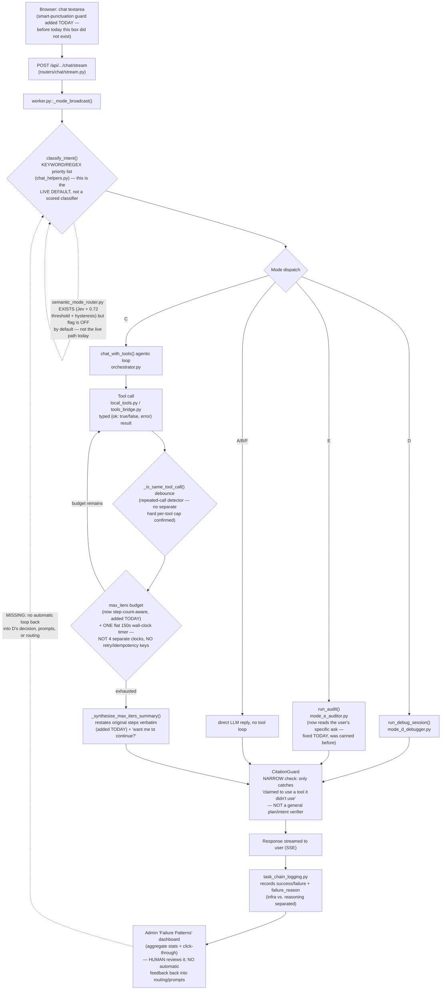

# AUREM System Audit v2 — vs. Coding-Agent SaaS Blueprint
**Date:** 2026-09-22 · **Type:** Read-only audit, no code changes made during this audit.

Ratings: **Confirmed** (verified directly, live or in source) / **Inferred** (reasoned from adjacent code) / **Unknown** (could not verify — flagged, not guessed).

---

## 1. PRODUCT & SCOPE

**Have:** Repo connect (GitHub App), chat that explains/plans/edits code, diff-before-apply via the loop/ship flow, multiple slash-style modes (A general, B advisory, C agentic build, D debug, E audit, F engage/marketing copy).

**Scope creep vs. a tight v1:** Confirmed — the live product is far wider than the blueprint's minimal v1. It has 6 modes (not 1 reliable slash command), a marketing/engage mode (F), a "Parliament" multi-model council, an Ask-Advisor side panel with its own screen-capture, founder-offer/promo systems, win-back campaigns, CASL compliance tooling, and a `browser-extension/aurem-context-bridge` for capturing console/network errors from the user's own site. None of this is "wrong," but it is materially more surface area than the blueprint's stated MVP, which explicitly lists multi-repo orchestration and autonomous background tasks as **NOT v1** — those two specific items are, however, correctly still absent.

**Confidence:** Confirmed (mode taxonomy, admin router count ~25 files, browser extension folder all directly inspected).

---

## 2. RELIABILITY ARCHITECTURE

**a) Agent loop — terminal states:** Confirmed **typed**, not ambiguous. `services/orchestrator.py` has an explicit "Turn-Completion Contract" with named states (`EXPLICIT-PARTIAL`, etc.) — a bare "want me to continue?" is never sent as an idle/silent ending; it's always attached to a real partial-result wrapper (`_wrap_as_explicit_partial`).

**b) Planning — typed step-plan object:** **Partial, and new as of today.** Before this session there was no step-plan object at all — a multi-step ask just ran through the same generic tool-call loop with a fixed `max_iters=4` budget. As of today I added `_detect_explicit_multistep()` (detects enumerated step lists) + a proportional `max_iters` bump + step restatement in the fallback message. This is **not** the blueprint's full `{id, description, status}` object with a hard "not done until every step is done-or-skipped-with-reason" gate — it deliberately stops short of that because auto-declaring a step "done" without real evidence would be a fabrication risk in a codebase that otherwise works hard to avoid exactly that (CitationGuard, `verify_llm_findings`). Full typed status tracking is still a gap.

**c) Input normalization:** **Partial, and new as of today.** Before this session, the chat textareas had zero smart-punctuation protection — literal `--` and straight quotes were being silently mangled by the browser. Fixed today (`spellCheck=false` + `autoCorrect=off` + a `beforeinput` guard) on both the main composer and the Advisor panel textarea. This is frontend-only and punctuation-specific — there is no backend-side general input normalizer (encoding, whitespace, etc.).

**d) Tool design — explicit SUCCESS/FAILED:** Confirmed. `services/local_tools.py` returns a typed `{"ok": True/False, "error": "..."}` shape consistently, not free text the caller has to interpret.

**e) Orchestration/routing — THE important one:** **Confirmed keyword/substring-based in production today.** `services/chat_helpers.py::classify_intent()` is a regex/substring priority list (checked directly: a message that only *mentions* "error" and "audit" in passing, with a real captured console error attached, gets misrouted). A confidence-scoring layer (`services/mode_classifier.py`) exists and is broadcast to the frontend, but until today it **decorated the UI only — it gated nothing**. As of today I built `services/semantic_mode_router.py` — a Jev-based scored classifier with a 0.72 confidence threshold + 2-turn hysteresis that actually gates dispatch — but it is **feature-flagged OFF by default** (`SEMANTIC_MODE_ROUTER_ENABLED`). So: plainly, the live default routing is still keyword-based today. It is not yet "smart" in production; the smart version exists in code but is not turned on.

**f) Timeouts/retry:** **Confirmed one flat model, not four clocks.** `orchestrator.py` has exactly one per-turn wall-clock budget (`ORCH_PER_TURN_BUDGET_S`, default 150s) plus an iteration-count cap. There is no separate connect / first-token / stream-idle / total-deadline split, no visible bounded-retry-with-jitter, and no idempotency-key dedup on retries. This is Bug 4 of the current work order — not yet started as of this audit.

**g) Loop prevention:** **Confirmed debounce exists; hard per-tool cap not confirmed.** `_is_same_tool_call()` in `orchestrator.py` detects identical repeated tool calls. I did not find a separate hard cap on calls to one specific tool (independent of the overall `max_iters` budget) — Unknown/likely does not exist as its own control, only the shared iteration ceiling.

**h) Verification before send:** **Confirmed, but narrow — not a general plan/intent verifier.** `services/citation_guard.py`'s `CitationGuard` exists specifically to catch the LLM *claiming* to have used a tool it didn't actually call (`unverified_tool_claim`). `mode_e_auditor.py::verify_llm_findings()` similarly checks audit findings against real file content — but only inside Mode E. There is no general-purpose "does this response actually match the plan/steps the user asked for" checker across all modes.

**Net:** of the 8 reliability boxes, 2 are solid (tool design, loop debounce), 1 is solid-with-caveat (terminal states), 3 are newly-partial as of today's session (input normalizer, planning, routing — routing's real fix exists but is off), 1 is narrow-scope-only (verification), 1 is not started (4-clock timeout/retry).

---

## 3. AI / MODEL LAYER

**Routing/fallback per role:** Confirmed, documented (not just tribal knowledge) — the public disclosure page itself (`ai-code-processing.md`) states it: Claude Sonnet 4.5/4.6 for Council A (primary code-gen), DeepSeek for Council B (validation/light fixes), GLM-5.2 as LongCat fallback, Groq for low-latency utility tasks. `services/llm/_routing.py` has per-mode token/temperature budgets and model-class constants (`_CLAUDE_MODES`, `_DEEPSEEK_HOSTS`).

**Cost controls:** Confirmed real and code-enforced, not display-only — `services/usage.py` has `assert_has_budget`/`assert_has_task_budget` that raise HTTP 402 when a user is out of budget.

**New-model evaluation gate:** **Does not exist as a process — confirmed the hard way, this session.** The Jev classifier claim ("already integrated, benchmarked, 2.5x faster/6.75x cheaper") had **no saved benchmark script or log anywhere in the repo** — only prose in a changelog. It only got verified because the founder personally refused to accept it and demanded a live proof; I then made a real API call and confirmed the code path is genuinely real and working, but the specific historical benchmark numbers are not independently reproducible. This is exactly the failure mode Section 3 warns about, and it is not hypothetical — it happened in this exact session. There is no standing gate that would have caught this automatically before it reached production code.

**Version pinning:** Inferred partial — model strings are versioned in code (`typesafe/jev-1.13-20260917`, specific Claude version numbers), but I did not confirm a per-response stored record of "which exact model version served this specific reply" for bug-report reproduction.

---

## 4. DATA & INFRASTRUCTURE

**Environments:** Confirmed dev/sandbox + production exist. **No staging environment found** — zero references to a staging tier anywhere in `main.py` or env files. New routing/classifier logic (like the semantic mode router) has nowhere to "prove itself" before either a dev sandbox or real production — this matches finding 2e's flag being OFF by default as the de facto safety net instead of a staging tier.

**Backups tested by restore:** Confirmed, and genuinely well-built — `services/db_restore.py::restore_to_scratch()` performs real restores into an isolated scratch namespace (never overwrites production), and `services/restore_drill_cron.py` runs this **automatically on a recurring schedule**, registered at boot in `main.py`. This is one of the strongest-verified items in the whole audit.

**Secrets storage:** Inferred — `.env`-based, `os.environ.get(...)` pattern used consistently in `main.py`; GitHub PATs are stated as "encrypted at rest (HKDF-Fernet)" per the disclosure doc. Did not independently audit every log line for accidental plaintext secret leakage, though `scripts/g4_secret_scanner.py` and `scripts/bundle_secrets_sweep.py` exist specifically to catch that class of bug pre-deploy.

**Scaling plan (what breaks first at 10x):** Unknown — no document or config found stating this explicitly.

---

## 5. SECURITY & PERMISSIONS

**Repo write access as a separate grant from read:** Unknown — did not find explicit evidence of a two-step read-then-write grant flow distinct from the initial GitHub App install; the App-install model itself may bundle scopes at install time. Flagging as Unknown rather than guessing.

**Scoping enforced in code vs. prompt only:** **Confirmed partial.** `services/scope_drift_guard.py` exists and does enforce out-of-scope-write detection in code — but the enforcement is conditional: it only fires when the planner has explicitly declared which files it intends to touch. If the planner doesn't declare files, there is no enforcement for that turn. So: real code-level enforcement exists, but it has a gap, not blanket coverage.

**Bulk revoke — GitHub only, and confirmed NOT production-verified:** Confirmed. `services/github_bulk_revoke.py` exists and works for GitHub App installations specifically — but its own header comment states the live drill-repo verification (real DELETE against a real installation) **has never been run**, and destructive use is gated behind a feature flag (`github_bulk_revoke_live_verified`) that defaults OFF. No equivalent bulk-revoke tool was found for other access types (PATs, OAuth sessions) as a single combined action — `services/token_revocation.py` has `revoke_all_for_user` for JWT-session revocation specifically, but I did not confirm one button that revokes everything (GitHub + PAT + session) at once.

**Audit log:** Inferred to exist (`routers/admin_analytics.py::audit_feed` endpoint found) — did not verify immutability guarantees.

**Human approval gate on irreversible actions:** Confirmed for deploy-adjacent actions (the win-back campaign send flow requires `confirm=true` + has a `dry_run` mode, per earlier work this session) and for the bulk-revoke drill (feature-flag gated). Did not verify this exists for every high-blast-radius action (e.g., force-push specifically).

---

## 6. OBSERVABILITY & TELEMETRY

**Failure Patterns — confirmed exactly what it captures:** `routers/admin_analytics.py::failure_patterns()` (the `/failure-patterns` admin endpoint) does group-by aggregation over the `task_chains` collection: top failing task types, prompt patterns, and tool sequences, with first-seen/last-seen timestamps and a minimum-sample-size guard (raised to 20 specifically to stop a 1-of-3 sample being reported as a confident "33% fail rate" — a real prior bug that was fixed 2026-09-21).

**Infra failures separated from logic failures:** **Confirmed, and matches the blueprint's exact example.** `INFRA_FAILURE_REASONS` (in `services/task_chain_logging.py`) explicitly excludes rate-limit/5xx from every "reasoning failure" bucket and reports it separately as `infra_failures` — this was itself a fix, dated 2026-09-21, for the precise conflation the blueprint warns about.

**What it does NOT capture:** This is aggregate/statistical (group-by counts), not a step-by-step trace. There's a "click-through to the truncated failure reasoning text" for one pattern, but I found no dedicated **replay** UI that lets someone step through exactly what one specific user's one specific failed task saw and did, tool call by tool call.

**Alerting:** Confirmed for specific known drills (`send_founder_alert` fires on a failed rollback/restore drill) — did not confirm a general "any failure_reason spike pages someone" threshold alert exists for arbitrary new failure classes.

---

## 7. TESTING, EVAL & DEPLOY GATE

**Eval suite exists and is deploy-relevant:** Confirmed — `evals/harness.py` + `evals/prompts_quality.py` (12-prompt battery) + `evals/prompts_security.py` + `evals/runner.py`, persisting to `ora_eval_runs` and feeding an admin "Persona Quality Score" tile. `evals/runner.py` itself exits non-zero on a hard fail.

**Does a failing eval actually BLOCK deploy, or just log?** **Weak/unclear — a real gap.** `scripts/predeploy_gate.sh` is the actual deploy-blocking script (confirmed: it's explicitly built because "Emergent's Deploy button... never executes the project's own tests"). Its 10 lanes cover: backend pytest, frontend vitest, a regression-library lock-check, a timeout audit, an OWASP/CWE scan, integration-health snapshot, a bundle-secrets sweep, `qa_manifest` regen, regression-pattern re-verify, and a dependency CVE scan. **I did not find `evals/runner.py` (the adversarial/persona eval suite) called anywhere inside `predeploy_gate.sh`.** So: the eval infrastructure exists, but as far as I can verify it is not wired into the thing that actually gates a deploy — it feeds an admin dashboard tile, not the gate itself.

**Rollback tested, not theoretical:** **Confirmed tested, and this is a genuinely strong finding.** `services/rollback_drill.py` is described as "the most thoroughly validated piece of infrastructure in this codebase (25/25 tests + a live drill)," and `services/rollback_drill_cron.py` runs the same full snapshot→ship-bad-commit→rollback→byte-exact-verify harness on a **recurring weekly schedule automatically**, alerting the founder on any real failure. This is one of the best-verified items in the whole audit.

**Rule of Three (3rd repeat becomes a permanent regression test):** **Inferred, not confirmed as automatic.** Lane 8 of the deploy gate (`scripts/verify_regression_patterns.py` + `/app/memory/RECURRING_ISSUES.md` + `services/ora_fix_learning.py`) re-verifies known recurring-bug patterns on every deploy — but I did not confirm there's an automatic trigger that converts a 3rd occurrence into a new test without a human writing it. Likely still a human-driven step today.

---

## 8. ADMIN & OPS TOOLING

**What exists (confirmed, real router files):** ~25 distinct admin router modules, including: `admin_analytics.py` (audit feed, business pulse, system stats, council stats/health, failure-patterns, agent-tokens, token-pnl, digest), `admin_bin.py` (bulk revoke), `admin_ops_config.py` and `admin_bin.py` (flag-adjacent config), `backups_admin.py` (restore-drill history + manual trigger), plus the ones referenced elsewhere this session (`admin_onboarding_funnel.py` for win-back preview/send).

**Mapped against blueprint Section 8:**
| Blueprint item | Status |
|---|---|
| User/account lookup, funnel status, token spend | Confirmed (`usage/me`, `agent-tokens`, funnel-stage endpoints all seen live) |
| Model routing dashboard (council health/fallback) | Confirmed (`council/stats`, `council/health`, `council-health` alias) |
| Failure Patterns / telemetry viewer | Confirmed (Section 6 above) |
| Feature flags panel | Inferred (config-shaped routers exist; did not confirm a single unified toggle-without-redeploy UI) |
| Bulk revoke / access control | Confirmed for GitHub only (Section 5) |
| Support & suggestions inbox | Unknown — not found in this pass |
| Audit log viewer | Inferred (`audit_feed` endpoint exists; UI not independently confirmed) |

---

## 9. ONBOARDING & FUNNEL

**Distinct events, not conflated:** Confirmed, and this is a real strength. `routers/github_funnel.py` explicitly documents and separates `connect_repo_click` → `github_auth_started` → `app_install_granted` → `repo_selected` (and further stages) as **distinct named events**, with an explicit comment noting the exact confusion the founder flagged ("app_install_granted fires when... not from 'actually reached GitHub'") was already found and fixed. `services/journey_watch.py` adds SLO-style timing thresholds per stage (e.g., 10 minutes max between granting access and picking a repo) with founder alerting on breach.

**Activation event:** Inferred, not explicitly confirmed as ONE named canonical event — "first successful task" style signals exist scattered across usage/founder-offer/funnel-stage endpoints, but I did not find one single documented "this is THE activation event" definition.

**Drop-off tracking:** Confirmed at a basic level (`journey_watch.py`'s stage SLOs imply drop-off detection); a dedicated funnel drop-off report/chart was not independently confirmed.

---

## 10. BILLING & MONETIZATION

**Plan limits enforced in code, not just UI:** **Confirmed.** `services/usage.py`'s `assert_has_budget`/`assert_has_task_budget` raise real HTTP 402s server-side. A free-tier user cannot technically exceed their cap by just hiding a UI element — the check is in the request path.

**Token P&L visibility:** Confirmed — `admin_analytics.py::token_pnl` endpoint exists.

**Pricing model:** Inferred hybrid (tiered plans with token ceilings, per `PLAN_VALUE_USD` seen in `Settings.jsx` this session) — not a pure flat subscription.

---

## 11. LEGAL & COMPLIANCE

**AI disclosure:** **Confirmed, and better than a minimal checkbox.** `/app/frontend/src/pages/PolicyPage.jsx` links a dedicated "AI & Code Processing Disclosure" (`ai-code-processing.md`), last updated Feb 12 2026, stating in engineering-grade detail: what's accessed, retention per data type (e.g., selected file contents purged after task completion, diffs kept 90 days, task inputs 30 days), the real model-routing table, and explicit per-provider training-opt-out status with citations. This is genuinely strong and specific, not vague.

**Explicit "review diffs before merging" language:** Not independently re-confirmed in this pass beyond the disclosure doc's framing — Inferred present given the doc's overall tone, but I did not grep the literal sentence.

**Data retention/deletion path:** Confirmed stated per-data-type in the disclosure doc (see table above); did not independently verify a self-service "delete my data" execution path actually works end-to-end (vs. just being stated in the policy).

**IP/liability statement:** Unknown — not found in this pass; would need the Terms of Service doc itself, which wasn't opened.

---

## 12. TEAM & ROLES

**Reliability owner, model/routing owner, security owner, support/triage owner, final deploy authority:** **Does not exist as a codebase artifact — Unknown/organizationally undefined.** There is no RACI doc, no ownership metadata, nothing in code that names a person or role for any of these. Given this is currently a solo-founder-plus-agent operation, this is very likely true in reality too, not just unverifiable — worth naming plainly rather than inferring a false "someone probably owns this."

---

## 13. LAUNCH READINESS — scored against the blueprint's 10-item checklist

| # | Item | Status |
|---|---|---|
| 1 | All 8 reliability boxes (Section 2) implemented + regression-tested | **Not met** — 2 solid, 3 partial-as-of-today, 1 narrow, 1 not started (Section 2f) |
| 2 | Deploy-time eval suite wired into pipeline, actually blocking | **Not met as far as verified** — the eval harness exists; I could not find it called inside `predeploy_gate.sh` |
| 3 | Repo write-access separate, revocable grant from read | **Unknown** — not confirmed either way |
| 4 | Bulk revoke tested end-to-end | **Not met** — built for GitHub only, explicitly never live-verified, flag OFF by default |
| 5 | Funnel events logging correctly, verified against real signups | **Partially met** — distinct events confirmed in code; "verified against real signups" not independently re-confirmed this pass |
| 6 | Plan limits enforced in code | **Met** — confirmed real 402s |
| 7 | ToS/Privacy/AI-disclosure live and linked | **Likely met** — AI-disclosure confirmed strong; ToS/Privacy pages linked but not opened this pass |
| 8 | Backup restore tested at least once | **Met, and recurring** — automated weekly drill, not just once |
| 9 | One named reliability owner, one named deploy authority | **Not met** — no such artifact found |
| 10 | A real user's full task watched start-to-finish with zero silent failure | **Unknown** — not something a codebase audit can confirm either way |

**Score: 2 clearly met, 1 likely met, 2 partially met, 3 not met, 2 unknown — out of 10.**

---

## 14. AUREM'S ACTUAL PATTERN DIAGRAM (as-built, gaps included)

**What this diagram makes visible, plainly:**
- Routing (box D) happens on the raw keyword match **before** any scored-confidence gate takes effect in production — the smart version is built but dormant.
- There is exactly **one** timeout/retry box, not four — Bug 4 of the current work order, not yet started.
- Verification (box K) exists but is scoped to one specific fabrication pattern, not a general "did this match the plan" check — the arrow from the tool loop to the response does **not** pass through anything that checks intent-completeness before sending, beyond that narrow guard.
- The feedback loop (N back to D) is drawn as **missing** deliberately — failures get logged and displayed to a human, but nothing today automatically feeds a failure pattern back into the routing/prompt logic itself. That closing of the loop is manual today.

---

### One honest meta-note
This audit is graded against the blueprint text pasted into this conversation — I do not have any other document. Everything above is either something I directly opened and read in this codebase during this session, or explicitly marked Inferred/Unknown where I couldn't verify it that way.
