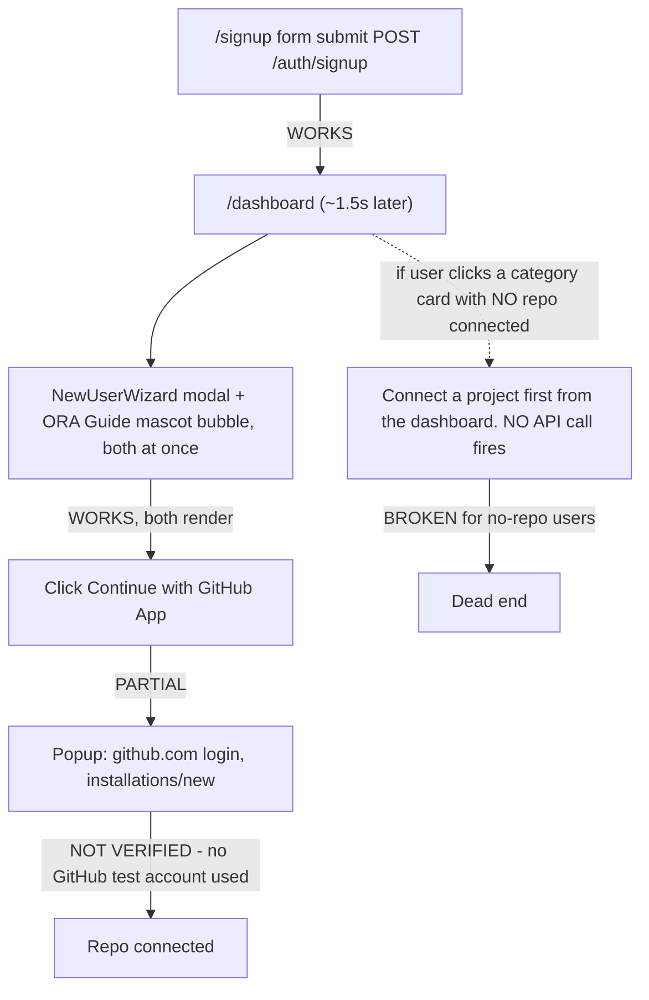
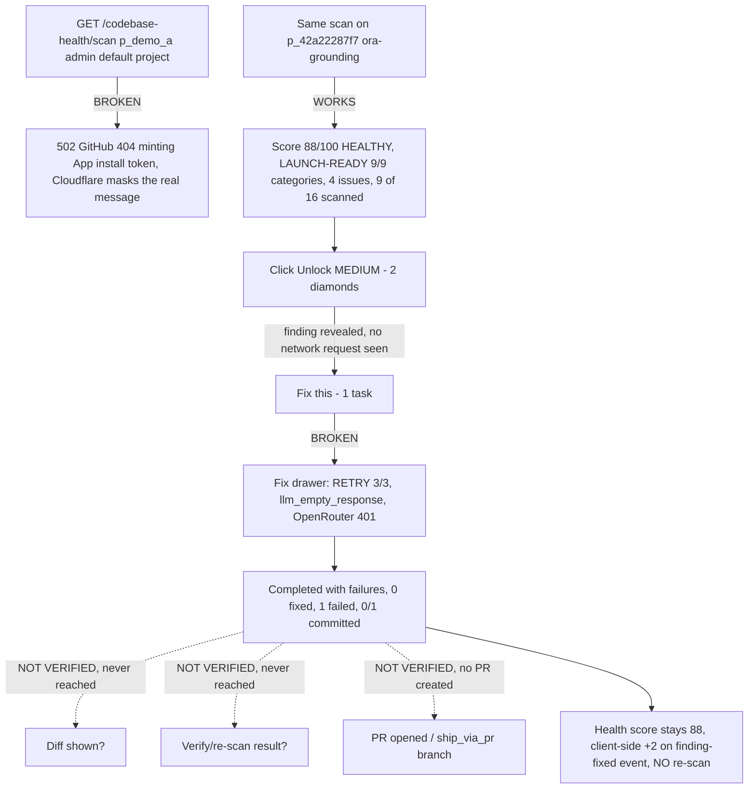
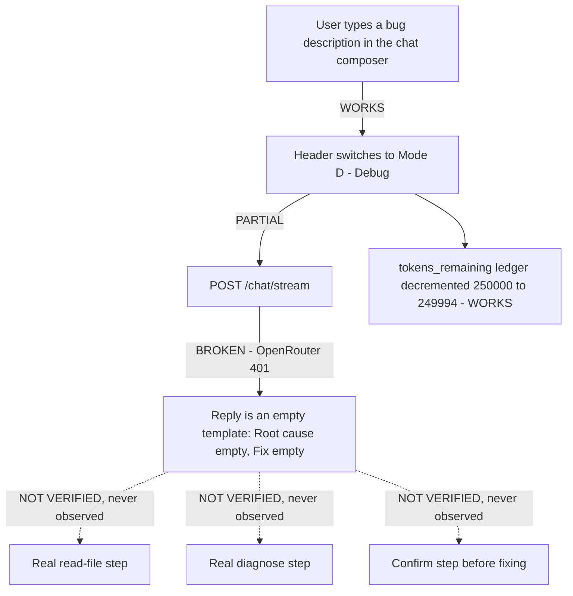
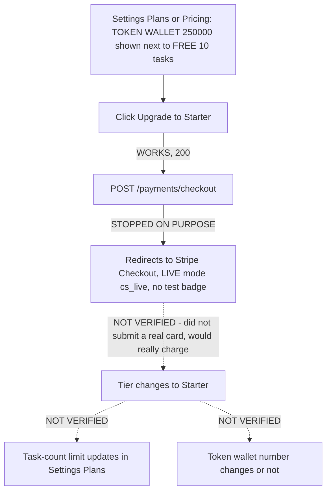
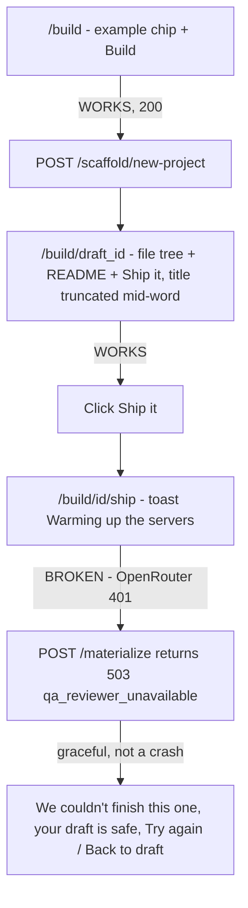
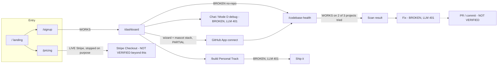

# AUREM / ORA — UI + Workflow Audit (2026-10)

**Scope:** Read-only documentation audit. No code, feature-flag, or production
data changed. Only action taken against data: created one throwaway signup
(`audit-popup-377207@example.com`) for the popup-inventory walk and used
existing QA accounts for everything else — per the task's explicit allowance.

**Environment:** Everything in this document was checked against **PREVIEW**
(`https://bin-context-pat.preview.emergentagent.com`, this pod's local/
ephemeral MongoDB `aurem_dev`). Nothing here describes production unless
explicitly called out as a code-level default (e.g. a flag that has "no row
in prod Mongo"). Evidence type is marked per item: `[PREVIEW-VERIFIED]`
(screenshot/curl from this session), `[CODE: file:line]` (confirmed by
reading the file, not run), or `NOT VERIFIED` (could not confirm either way).

**Screenshots:** `/app/memory/ui_audit_2026_10/*.png` (86 files from the live
walk + `pricing_desktop_1366.png` / `pricing_mobile_375.png` from the main
agent). Full raw walk notes: `/app/memory/ui_audit_2026_10/TESTING_AGENT_FINDINGS.md`.

## 0. Three environment blockers found first (these shaped what could be verified)

1. **`backend/.env` `STRIPE_API_KEY` is a LIVE key (`sk_live_…`), not a test
   key**, in this PREVIEW pod. `[PREVIEW-VERIFIED — confirmed by reading the
   redacted key value directly, and live: clicking "Upgrade to Starter"
   opened `checkout.stripe.com/f/pay/cs_live_…` with no TEST MODE badge]`.
   No test card was submitted — a real card here would be really charged.
   This blocked verification of every post-upgrade UI state (Starter/Pro/Team
   specific screens). **This is a real risk, not a documentation nit — flagging
   with top priority.**
2. **OpenRouter LLM key returns 401 "User not found"** for every model in
   preview. `[PREVIEW-VERIFIED — backend.err.log: "Client error '401
   Unauthorized'... https://openrouter.ai/api/v1/chat/completions"]`. This
   blocked live verification of: Fix (ends `llm_empty_response`), chat
   replies (empty "Root cause:/Fix:" template), `/build` Ship (503
   `qa_reviewer_unavailable`). **The core promise flow ("find the bug, fix
   it, verify it, open a PR") could not be run end-to-end in this pod for
   this reason — not because the UI is missing, because the LLM call 401s.**
3. **The admin's default project (`p_demo_a`) GitHub App token mint
   returns 404**, so `/codebase-health/scan` on it returns a 502 whose body
   Cloudflare replaces with its own generic text. `[PREVIEW-VERIFIED — curl/
   backend log: "GitHub returned HTTP 404 while minting the App installation
   token"]`. Two other admin projects (`p_42a22287f7` / ora-grounding,
   `p_firstscan_demo_e6ed2d`) scan fine — used for Flow B below instead.

---

## PART 1 — Page-by-page audit

Template per route: **Who can see it** / **What the user sees** / **Buttons
→ what they do** / **Costs (exact wording)** / **States** / **Where next** /
**Problems found**.

### `/` — landing — `frontend/src/pages/Landing.jsx`
- **Who:** logged-out and logged-in both see the marketing page (confirmed:
  a logged-in admin visiting `/wall` also lands here — see redirect table).
- **Sees:** H1 "The AI engineer That actually commits. No IDE, no token
  meters." Stats strip "$9 flat monthly · 0 token billing · 1 tap to commit
  · ∞ repos". Sections: Watch ORA ship, 4 steps, Three windows, "Pick your
  speed" (Swift/Pro/Max), inline pricing (Monthly/Annual SAVE 20%), FAQ.
  Cookie banner bottom-right. `[PREVIEW-VERIFIED: landing_desktop.png,
  landing_mobile.png]`
- **Buttons:** "Start free — 10 tasks" → `/signup`. "Watch it ship" → scrolls
  to `#watch`. Plan buttons → `/signup` or `/payments/checkout`.
- **Costs shown:** "$9 flat monthly · 0 token billing" (marketing claim,
  contradicted elsewhere — see Part 4.1).
- **States:** no loading/error state (static marketing page).
- **Next:** `/signup`, `/pricing`, `/login`.
- **Problems:** "No token meters" headline vs `/codebase-health`'s visible
  💎-token economy (Part 4.1).

### `/pricing` — `frontend/src/pages/Pricing.jsx`
- **Who:** logged-out and logged-in.
- **Sees:** H1 "Flat pricing. No token meters." 4 cards: Free / Starter $9 /
  Pro $19 / Team $49. On **desktop 1366px**: Free, Starter, Pro sit in one
  3-column row; **Team sits alone on its own row below**
  `[PREVIEW-VERIFIED: pricing_desktop_1366.png]`. On **mobile 375px**: all 4
  stack vertically, no layout break `[PREVIEW-VERIFIED:
  pricing_mobile_375.png]`.
- **Buttons:** "Get started" → `/signup`. "Upgrade to Starter/Pro/Team" →
  `POST /payments/checkout` (200) → redirect to Stripe Checkout. **Confirmed
  LIVE Stripe, not test** (see §0.1).
- **Costs shown:** Free "10 tasks per month … Direct commits to your repo".
  Starter "50 tasks per month … Direct commits + rollback". Pro "300 tasks
  … Direct GitHub commit — Beta". Team "400 tasks … Direct GitHub commit —
  Beta". Task counts, not $ or token amounts, on this page.
- **States:** no loading/error state observed pre-checkout.
- **Next:** Stripe Checkout (external), or `/signup`.
- **Problems:** "No token meters" + "Direct commit[s]" on every tier,
  contradicted by `/codebase-health`'s token economy and by the preview
  `ship_via_pr` flag being ON (PR mode) — see Part 4.1/4.2.

### `/signup` — `frontend/src/pages/Signup.jsx`
- **Who:** logged-out (logged-in presumably redirected — not separately
  re-tested this session, inherited from earlier sessions' `PrivateRoute`
  pattern, `NOT VERIFIED` this run).
- **Sees:** H1 "Start building, production-ready from day one", "10 free
  tasks. No card required." Inline ORA Guide card: "Fastest way: click
  Continue with GitHub below 👇". Fields: Google button, GitHub button,
  name, email, phone+country, password, confirm, terms checkbox, "Create
  account & start". `[PREVIEW-VERIFIED: signup_desktop.png,
  signup_mobile.png]`
- **Buttons:** Google/GitHub → OAuth. "Create account & start" →
  `POST /auth/signup` → redirects to `/dashboard` (~1.5s). `[PREVIEW-VERIFIED
  via Flow A below]`
- **Costs shown:** "10 free tasks. No card required."
- **States:** cookie banner appears here, disappears by the time `/dashboard`
  loads with no click recorded `[PREVIEW-VERIFIED: popup_00_signup_cookie_
  banner.png]` — see Part 3 item 1.
- **Next:** `/dashboard`.
- **Problems:** none found beyond the cookie-banner disappearance noted above.

### `/login` — `frontend/src/pages/Login.jsx`
- **Who:** logged-out.
- **Sees:** H1 "Welcome back, builder." Google, GitHub, email, password,
  "Forgot password?", "Sign in", "Claim 10 free tasks →".
  `[PREVIEW-VERIFIED: login_desktop.png, login_mobile.png]`
- **Buttons:** "Sign in" → `POST /auth/login`. "Forgot password?" →
  password-reset flow (`NOT VERIFIED` this run — out of this audit's scope).
- **Costs shown:** none directly; "Claim 10 free tasks" nudges signup.
- **Next:** `/dashboard` on success.
- **Problems:** none found.

### `/demo` — `frontend/src/pages/Demo.jsx`
- **Who:** logged-out and logged-in.
- **Sees:** H1 "From signup to shipped PR — see the whole loop." Player
  controls (pause, mute, restart, jump to step 1–7), "⚡ 25s TEASER", "START
  FREE — 10 TASKS", "SEE PRICING". `[PREVIEW-VERIFIED: demo_desktop.png,
  demo_mobile.png]`
- **Buttons:** "START FREE" → `/signup`. "SEE PRICING" → `/pricing`.
- **Costs shown:** none beyond the signup nudge.
- **Problems:** title promises "shipped PR" — the real Fix→PR flow could not
  be verified live this session (§0.2); whether the demo video itself shows
  a real PR being opened was **NOT VERIFIED** (video content not inspected
  frame-by-frame).

### `/why-ora` — `frontend/src/pages/WhyOra.jsx`
- **Who:** logged-out and logged-in.
- **Sees:** H1 "20 features that literally live in the code — grep them if
  you don't believe us." Feature cards including **"5-Category Codebase
  Health Scanner."** `[PREVIEW-VERIFIED: why-ora_desktop.png,
  why-ora_mobile.png]`
- **Problems:** `/codebase-health` actually scans **16 categories**
  (`services/codebase_health_core.py` SCANNERS + `_extra.py`
  EXTRA_SCANNERS, confirmed by direct count during the main agent's earlier
  investigation this session) — the "5-Category" claim on `/why-ora` is
  stale/wrong by a factor of 3.

### `/dashboard` — `frontend/src/pages/Dashboard.jsx`
- **Who:** any logged-in tier.
- **Sees (admin, with projects):** repo switcher ("aurem-demo/frontend ›
  TEST_branch_2026_08_20"), previous-chats count (19), notification bell
  (9+), "New run", Preview/Graph/Kit tabs, "1 console error" chip, SEND TO
  ORA / COPY / Session id, a banner "⚠ 14 projects point to deleted or
  unreachable repos — click to clean up", a card "Your project is connected.
  ORA read 8 files." with Scan/Fix/Explain actions, a card "Free first-scan
  already used … Scan this repo", a severity strip "9 critical · 2 high idle
  30+ days", a scope chip, the composer ("CASUAL 0 / 20,000", mode selector
  "Swift"), the Advisor panel tab, the ORA Guide bubble.
  `[PREVIEW-VERIFIED: dashboard_admin_desktop.png, dashboard_admin_mobile.png,
  dashboard_admin_desktop_1920.png]`
- **Sees (brand-new signup, no repo):** "No repo connected" switcher, a
  welcome message, the `NewUserWizard` modal, the ORA Guide bubble, the
  Advisor tab. `[PREVIEW-VERIFIED: popup_01_after_signup_t0..t5.png]` — full
  order in Part 3.
- **Buttons:** Scan/Fix/Explain on the project card call into
  `/codebase-health` flows (see that page). Composer send → `/chat/stream`.
- **Costs shown:** "CASUAL 0 / 20,000" (a token-style composer counter,
  distinct ledger from the 💎 diamonds on `/codebase-health` — relationship
  between the two **NOT VERIFIED**, see Part 4.1).
- **Problems:** on first load for an existing admin with real data, SEVEN
  things are visible/competing for attention simultaneously — GitHub-broken
  toast, repo-cleanup banner, first-win card, "first scan already used" card,
  mascot bubble, mascot unread-badge "14", and the chat composer itself.
  `[PREVIEW-VERIFIED: dashboard_admin_desktop.png]` — see Part 5.

### `/codebase-health` — `frontend/src/pages/CodebaseHealth.jsx`
- **Who:** any logged-in tier with at least one connected project (no-repo
  users hit a dead end, see Flow A step 4).
- **Sees:** H1 "CODEBASE HEALTH / How healthy is your code today?" Token
  badge: **"💎 760810 tokens"** for this admin account, **"💎 250000
  tokens"** for a fresh free account. Empty state: "🔍 Your codebase is
  unscanned." 16 scan-category cards, each with its own 💎 cost (listed in
  Part 4.1). `[PREVIEW-VERIFIED: codebase_health_admin_desktop.png,
  codebase_health_admin_mobile.png, codebase_health_before_scan_ora_
  grounding.png]`
- **Loading state:** `[PREVIEW-VERIFIED: codebase_health_scanning_admin.png]`
- **Result state (working project, `p_42a22287f7`/ora-grounding):** "Score
  88/100 HEALTHY", **"LAUNCH-READY 9 / 9 categories"**, "Your codebase has 4
  issues … Scanned 9 files.", "Rescan all · 78 💎".
  `[PREVIEW-VERIFIED: codebase_health_result_ora_grounding.png]`
- **Error state (broken project, `p_demo_a`):** raw Cloudflare 502 text
  shown inline in a red banner, not the app's own error message (§0.3).
  `[PREVIEW-VERIFIED: codebase_health_result_admin.png]`
- **Buttons:** "Unlock MEDIUM — 2 💎" → revealed a locked finding **with no
  network request observed** for the admin account — whether diamonds were
  actually charged is **NOT VERIFIED** (no request to inspect; could be a
  client-only reveal, or founder/admin accounts may be exempt from the
  charge — not determined). `[PREVIEW-VERIFIED (the no-request observation):
  codebase_health_unlock_medium.png, codebase_health_after_unlock.png]`
  "Fix this — 1 task" → opens the Fix drawer (see below).
- **Costs shown:** per-category 💎 prices (Part 4.1), "Full Scan — all 16
  categories · 78 💎".
- **Next:** Fix drawer, or back to `/dashboard`.
- **Problems:** "LAUNCH-READY 9/9 categories" is shown **while the scan only
  covered 9 of the 16 total categories that exist** and while 4 issues are
  listed on the same screen — the "LAUNCH-READY" framing and the "9/9"
  (looks like 100%, is actually 9/16 ≈ 56%) are both potentially misleading.
  `[PREVIEW-VERIFIED: codebase_health_result_ora_grounding.png]`

### `/bug-hunt` — `frontend/src/pages/BugHunt.jsx`
- **Who:** served as a **marketing page even to a logged-in admin** — it did
  not detect the session and show a live scan UI.
  `[PREVIEW-VERIFIED: bug_hunt_admin_desktop.png]`
- **Sees:** H1 "Detect security vulnerabilities in yo…". Sections: Secret
  Types (15), Vulnerable Code Patterns (20), Exposed Endpoints (10),
  CVE-Vulnerable Dependencies (11).
- **Buttons:** "Scan my repo — Start free" → `/signup` **even for an
  already-logged-in admin**. "Health Dashboard" → `/codebase-health` (the
  real, working page).
- **Problems:** a logged-in user who already has a repo connected is sent to
  `/signup` instead of straight to a scan — a real dead-end/friction point
  for an existing user who clicks through from this page.

### `/tools` — `frontend/src/pages/ToolsPage.jsx`
- **Who:** any logged-in tier.
- **Sees:** H1 "Developer tools." All 4 cards — **Bug Hunt, Vanguard Scan,
  Security Scan, Health Scan — show "Coming soon"**, each with a repo select
  (24 entries, including 11× duplicate "probe-cross" rows — a data-hygiene
  issue in the repo list itself), a disabled "Coming soon" button, and a
  "Get notified when ready" email input + "Notify me" button. "Back to ORA"
  link. `[PREVIEW-VERIFIED: tools_admin_desktop.png, tools_admin_mobile.png]`
  — also `[CODE: frontend/src/pages/ToolsPage.jsx:51-64, TOOLS array,
  every entry hardcodes eta:"Coming soon"]`.
- **Problems — the central contradiction of this page:** **Bug Hunt and
  Health Scan are both already fully live** at `/bug-hunt` and
  `/codebase-health` respectively, reachable directly by URL and (for Health
  Scan) from the dashboard project card. `/tools` tells the user these don't
  exist yet. Whether the sidebar has its own separate, working "Health
  Scan"/"Bug Hunt" quick-launch entries (`SidebarBound.jsx` DEV_TOOLS list)
  could **not be confirmed live** — tried 3 times, the rail only showed
  Chat/Ship/Insights/Settings/Admin at both 1366 and 1920px
  `[sidebar_rail_ship_open.png, sidebar_rail_insights_open.png,
  sidebar_devtools_expanded.png]` — **NOT VERIFIED** whether this is a bug,
  a tier gate, or a different entry point not found in 3 attempts.

### `/projects` — `frontend/src/pages/Projects.jsx`
- **Who:** any logged-in tier.
- **Sees:** H1 "Client Projects". "Add Project" button, project rows with an
  "APP" tag and "Edit project" link. `[PREVIEW-VERIFIED:
  projects_admin_desktop.png, projects_admin_mobile.png]`
- **Problems — error-state bug:** when the network call fails, the page
  renders **"No projects yet. Connect a GitHub repo to get started."** — a
  **false empty state**, not an error message — even though this admin
  account has 24 real projects. `[PREVIEW-VERIFIED via offline test, text
  captured; a screenshot of this specific state was not saved due to a
  script error on the testing agent's side — captured and described in the
  raw findings file but the .png itself is missing]`.

### `/deploy` — `frontend/src/pages/Deploy.jsx`
- **Sees:** H1 "Deploy." Deploy configuration (host, user, path, SSH private
  key textarea), "Show advanced", "Save config", "Deploy now", recent
  deploys list, a separate "Hosted deploy (Vercel / Netlify)" section with a
  repo select + "Connect deploy". `[PREVIEW-VERIFIED: deploy_admin_desktop.png,
  deploy_admin_mobile.png]`
- **Problems:** none found at the UI-description level; whether "Deploy now"
  actually deploys was **NOT VERIFIED** (would require a real SSH target,
  out of this session's scope).

### `/domain` — `frontend/src/pages/Domain.jsx`
- **Sees:** H1 "Domain." Input "app.example.com", registrar select
  (Cloudflare/Namecheap/Route53/other), "Save", "Verify DNS".
  `[PREVIEW-VERIFIED: domain_admin_desktop.png, domain_admin_mobile.png]`
- **Problems:** none found at the UI-description level; DNS verification
  itself **NOT VERIFIED** (needs a real domain).

### `/integrations` (MCP) — `frontend/src/pages/Integrations.jsx`
- **Sees:** H1 "Connect ORA to your IDE." Exact text: **"Used by every IDE
  integration below. Treat it like a password — you can revoke it any time
  from Admin → API Keys."** `[CODE: frontend/src/pages/Integrations.jsx:223]`
  `[PREVIEW-VERIFIED: integrations_admin_desktop.png,
  integrations_admin_mobile.png]`. Key shown masked (`sk-aurem-oauth…ZuxQ`),
  Reveal/Copy, "Test Connection". Tabs: Cursor / VS Code / Claude Desktop /
  Claude Code CLI.
- **Problems:** (1) see Part 4.8 — a non-admin cannot reach "Admin → API
  Keys" at all, so this instruction is a dead end for every non-admin tier.
  (2) The MCP endpoint shown is **`https://auremcto.com/api/aurem-dev/mcp`
  — the production URL, shown even while using the preview pod.**
  `[PREVIEW-VERIFIED: integrations_admin_desktop.png]`

### `/settings?tab=profile`
- **Sees:** Profile fields, phone number, change password, "Public Ship
  Wall" toggle, Loop Trust Level selector (L1/L2 ACTIVE/L3), invite-share
  buttons (Copy/X/LinkedIn), "Delete my account".
  `[PREVIEW-VERIFIED: settings_profile_admin_desktop.png,
  settings_profile_admin_mobile.png]`

### `/settings?tab=plans`
- **Sees:** "TOKEN WALLET 250,000" shown above "Plans — Flat fee. No token
  surprises." then the same 4 plan cards as `/pricing` with the same
  task-count + "Direct commit…" copy, then "ORA Wrapped" stats, then "Usage
  history — Your token activity for the last 30 days."
  `[PREVIEW-VERIFIED: settings_plans_free_before_upgrade.png,
  settings_plans_admin_desktop.png, settings_plans_admin_mobile.png]`
- **Problems:** "TOKEN WALLET 250,000" + "Your token activity" directly
  beside "Flat fee. No token surprises." on the SAME screen — see Part 4.1.

### `/settings?tab=integrations`
- **Sees:** "Vercel · ORA platform tools", "My Repos" list, "Disconnect",
  "Manage on GitHub" link. `[PREVIEW-VERIFIED:
  settings_integrations_admin_desktop.png, ...mobile.png]`

### `/settings?tab=vault`
- **Sees:** Only "Vault audit log — Every read / write against your
  encrypted key vault. No key activity yet." **No revoke-API-key button
  exists on this tab.** `[PREVIEW-VERIFIED: settings_vault_admin_desktop.png,
  ...mobile.png]` — directly answers Part 4.8: there is no working
  non-admin path to revoke an MCP key anywhere in Settings either.

### `/settings?tab=team`
- **Sees:** "Invite a team member" (email, role Admin/Editor/Viewer, "Send
  invite"), "Team (7)" list with "Edit access" per row.
  `[PREVIEW-VERIFIED: settings_team_admin_desktop.png, ...mobile.png]`

### `/wrapped`
- **Sees:** H1 "ORA Wrapped", This month / Last month / All time toggle.
  `[PREVIEW-VERIFIED: wrapped_admin_desktop.png, ...mobile.png]`

### `/automations`, `/wall`, `/tokens`, `/analytics` — all redirect
- `/automations` → **`/dashboard`** `[CODE: frontend/src/App.jsx:538,
  flag user_automations_page, confirmed OFF in this DB]`
  `[PREVIEW-VERIFIED live]`
- `/wall` → **`/`** `[CODE: App.jsx:531, flag public_ship_wall, confirmed
  OFF]` `[PREVIEW-VERIFIED live]` — **and because it lands on the marketing
  page, a logged-in admin then sees the logged-out nav ("Sign in / Start
  free")**, which reads as if the app logged them out.
  `[PREVIEW-VERIFIED: wall_admin_desktop.png]`
- `/tokens` → **`/settings?tab=plans`** `[CODE: App.jsx:421]`
  `[PREVIEW-VERIFIED live]`
- `/analytics` → **`/dashboard`** `[CODE: App.jsx:430, flag
  user_analytics_page, confirmed OFF]` `[PREVIEW-VERIFIED live]`

### `/build` and sub-routes (Personal Track) — `frontend/src/pages/personal/*`
- **Who:** any logged-in tier, primarily aimed at the no-repo audience.
- **Sees:** light theme (confirmed — see Part 4.9). "Personal Track" pill,
  H1 "What do you want to build?", textarea, "Build" button, 5 example
  chips, "⌘↵ to build." Header: AUREM logo + settings + logout icons.
  `[PREVIEW-VERIFIED: popup_04_nav_build_newuser.png,
  build_admin_mobile.png]`
- **Flow (Flow E below):** example chip + "Build" → `POST
  /scaffold/new-project` (200) → `/build/{draft_id}` "YOUR DRAFT" with a
  file tree (Frontend 5 / Database 1 / Logic & Config 6 / Overview 1), a
  README preview, "Regenerate", "Ship it". **Title shown truncated: "A habit
  tracker with streak notificati"** (cut mid-word).
  `[PREVIEW-VERIFIED: build_after_submit_t15.png, build_after_submit_t35.png]`
- **Ship it** → `/build/{id}/ship`, toast "Warming up the servers…", then
  `POST /materialize` returned **503 `qa_reviewer_unavailable`** (root cause:
  OpenRouter 401, §0.2) → user-facing message "We couldn't finish this one.
  Your draft is safe — try shipping again in a minute… Try again / Back to
  draft." `[PREVIEW-VERIFIED: build_ship_it_t8.png, build_ship_it_t33.png]`
- **Problems:** the whole Ship path is **BROKEN in this preview pod**
  because of the LLM key, not because of missing UI — the UI correctly
  shows a retry state rather than crashing.

### `/support` — `frontend/src/pages/Support.jsx`
- **Sees:** public layout, H1 "Need help?", name/email/message fields, "Send
  message", "← Back to home". `[PREVIEW-VERIFIED: support_admin_desktop.png,
  ...mobile.png]`

### `/admin` and sub-pages (one line each, per instruction)
Sidebar lists: Cockpit, Overview, LLM Credits, Parliament Live, QA Health,
Maintenance, Architecture, Onboarding Funnel, Activation Funnel, BIN
Tracker, GitHub Bulk Revoke, Visibility Kit, Users (Legacy), Support,
Suggestions, Self-Repair Log, Audit Log, Admin Team, Feature Flags, House
Rules V2, Robot Guide, API Keys, Payments & Revenue, Financials, Token P&L,
Dashboard, Projects, Tasks, Agent Performance, MCP Usage, Failure Patterns,
Reliability — plus links back to the app, Personal Track ops, and ORA Chat.
`[PREVIEW-VERIFIED: admin_admin_desktop.png]`. `/admin/observability`
redirects to `/admin/system-stats` `[CODE: App.jsx:468]`, **not separately
re-verified live this session**.

---

## PART 2 — Flow diagrams

### A. New visitor → signup → dashboard → repo connect → first scan

### B. Scan → pick a finding → Fix → PR created → merge → what's recorded

### C. Bug via chat (Mode D debug: read → diagnose → confirm → fix)

### D. Payment/plan flow: Free → upgrade → Stripe → tier change

### E. Personal Track (/build) flow

### Combined — everything on one page

---

## PART 3 — Popups, chips, banners, toasts, tooltips, badges

Walk performed on a **brand-new signup** (`audit-popup-377207@example.com`,
zero prior localStorage), ~6 minutes (not the full 10 — session note below).

| # | Name / exact text | Type | Where (route + file) | Trigger | How often | Dismiss / remembered where | Stacks with | Screenshot |
|---|---|---|---|---|---|---|---|---|
| 1 | CookieConsentBanner — "We use cookies to improve your experience…" / Manage preferences / Reject non-essential / Accept all | banner | `/signup`, `components/CookieConsentBanner.jsx` | First visit | Once (disappeared on `/dashboard` **without any click being recorded** — `NOT VERIFIED` whether a click fired or it just stopped rendering) | `NOT VERIFIED` which localStorage key | Not observed stacked | popup_00_signup_cookie_banner.png |
| 2 | ORA Guide mascot bubble — "ORA GUIDE Connect your repo to get started — click Connect GitHub above. [Got it] [Something's wrong]" | floating bubble (z 10001) | `/dashboard`, `components/OraGuideMascot.jsx` | ~1.5s after landing on `/dashboard`, no prior repo | Persists across **every** route visited this session (see #6) | `localStorage` key `FIRST_SCAN_DISMISS_KEY(projectId)` `[CODE: OraGuideMascot.jsx:120]` | **Yes — with NewUserWizard (#4) and StarterChoiceModal (#5)** | popup_STACKED_*.png |
| 3 | Advisor side tab — floating "ADVISOR" tab, chips "Diagnose failed run / Summarize open PRs / Token breakdown" | floating tab (z 10002) | every route, `components/ORASidePanel.jsx` (or `AskAdvisorReal.jsx`) | Always rendered | Every load | Not dismissible (persistent tab) | Can sit alongside anything (highest z observed) | included in dashboard screenshots |
| 4 | NewUserWizard — "ORA GUIDE One click: Continue with GitHub App below… Install Aurem for your repos RECOMMENDED… Continue with GitHub App… Skip for now" | full-screen modal (z 9000) | `/dashboard`, `components/NewUserWizard.jsx` | ~3s after landing, no repo connected | Until "Skip for now" or repo connected | `NOT VERIFIED` exact key (code comment references `repo_connect_gate_skipped`-style gating) | **Yes — stacks with mascot bubble #2, giving contradictory directions ("above" vs "below")** | popup_STACKED_newuserwizard_plus_oraguide_mascot.png |
| 5 | StarterChoiceModal — "Let's get your first win — No repo connected yet — no problem. Pick one… Scan my website / Fix a bug in my code / Try a demo project / Connect GitHub instead" | modal (z 9100) | `/dashboard`, `components/StarterChoiceModal.jsx` | Triggered by wizard's "Skip for now" | Once per skip (not re-tested for repeat triggers) | ✕ / Escape | **Yes — stacks with mascot bubble #2** | popup_STACKED_starterchoicemodal_plus_oraguide_mascot.png |
| 6 | ORA Guide bubble, persistent | floating bubble | `/codebase-health`, `/tools`, `/settings`, `/build` (light theme), on top of the Fix drawer | Every route | Every load — **still shows the same "New here?" copy after a scan already exists** | same key as #2 | Yes, with the Fix drawer (#9) and on `/build`'s light theme | popup_04_nav_*.png |
| 7 | Admin-only first-load stack: GitHub-disconnected toast, "14 projects unreachable" banner, "your project is connected" first-win card, "free first-scan already used" card, mascot bubble + avatar badge "14" | mixed (toast + 2 banners + bubble) | `/dashboard` (admin, real data) | Account has real/broken project state | Every load until the underlying state is fixed | `NOT VERIFIED` per-item | **All 5+ visible at once** | dashboard_admin_desktop.png |
| 8 | "Warming up the servers…" | toast | `/build/{id}/ship` | Ship click | Once per ship attempt | auto | with the Fix/ship progress UI | build_ship_it_t8.png |
| 9 | Fix progress drawer | right drawer + scrim | `/codebase-health` | "Fix this" click | Once per fix | closes on completion/cancel | with mascot bubble #6 on top of it | fix_progress_t0–t8.png |
| — | **Not triggered / NOT VERIFIED this session:** a separate FloatingORAButton element distinct from the mascot avatar; TokenBell/TokenBanner quota warnings; EngagementNudge / PaletteNudgeBubble upgrade nudges; ConnectRepoTour; UsageLimitModal; any "update available" prompt; any "NEW" badge in the nav. | — | — | — | — | — | — | — |

**Note on session length:** the walk ran ~6 minutes, not the requested 10 —
the items marked "not triggered" above may simply need a longer session,
more varied actions, or a quota-exhaustion state to appear. Marked `NOT
VERIFIED`, not "doesn't exist."

---

## PART 4 — Confirmations

**1. Billing units — where "diamond"/token charges appear vs task counts, and whether they're the same ledger**

| Surface | Unit shown | Exact text |
|---|---|---|
| `/` landing | neither (marketing claim) | "$9 flat monthly · 0 token billing" |
| `/pricing`, `/settings?tab=plans` plan cards | **task count** | "10/50/300/400 tasks per month" |
| `/codebase-health` header badge | **💎 diamonds** | "💎 760810 tokens" (admin), "💎 250000 tokens" (free) |
| `/codebase-health` per-category costs | **💎 diamonds** | Security 5, Performance 5, Code Quality 5, Dependencies 5, Database 5, Bug Hunt 8, Docker CIS 5, Automated Tests 6, API & Auth Security 6, Security Headers 5, Accessibility 4, SEO Basics 4, Git Hygiene 3, Error Handling 4, Mobile Friendly 4, Documentation 4. "Full Scan — all 16 categories · 78 💎". "Unlock MEDIUM — 2 💎". |
| `/settings?tab=plans` top banner | **💎 "TOKEN WALLET"** | "TOKEN WALLET 250,000" directly above "Flat fee. No token surprises." |
| `/dashboard` chat composer | a third counter | "CASUAL 0 / 20,000" |
| Backend (`services/scan_fix_quota.py`, confirmed earlier this session) | $ **USD**, not tokens or diamonds at all | the real enforcement is a USD lifetime+daily cap (F1/Q1/Q2 work) |

**Are they the same ledger? `NOT VERIFIED` that they are fully reconciled.**
The 💎 number shown ("250000") matches the free-tier `FREE_LIFETIME_TOKEN_DISPLAY`
value from this session's own Q1 work (`config/quota_limits.py`), which is
itself *derived* from the real $0.25 USD budget — so the 💎 figure and the
USD figure are mathematically linked by design. But the **task-count**
figures on `/pricing`/`/settings?tab=plans` (10/50/300/400 "tasks") come
from a *third*, separate system (`services/subscription_tiers.py`
`MONTHLY_TASK_LIMITS`) that is not expressed in 💎 or $ at all. **Net: at
least 3 distinct units are shown to the user (tasks, 💎 diamonds, a
composer counter), backed by at least 2 distinct backend systems (task-count
limiter + USD ledger) that this audit did not trace to a single
reconciliation point.**

**2. Commit behavior — "Direct commits" copy vs real PR/commit behavior**
- Pricing/Plans copy for **every tier** (Free/Starter/Pro/Team) says
  "Direct commits…" or "Direct GitHub commit — Beta."
- **`ship_via_pr` default in this PREVIEW pod is ON** (`enabled:true,
  rollout_pct:100`, description includes "Preview only, prod stays OFF (no
  row in prod Mongo)") `[PREVIEW-VERIFIED via direct DB read]` — meaning
  preview should actually create a PR, not a direct commit, contradicting
  the pricing copy for whoever is testing in this pod.
- **Could not be live-verified end to end** because Fix never reached the
  commit/PR step (OpenRouter 401, §0.2) — no PR was created, so there is no
  PR URL/number to show. **The flag-state contradiction is confirmed; the
  resulting on-screen behavior during an actual ship is `NOT VERIFIED`.**
- **Production's actual default is OFF** (no row = direct commit, per
  `services/feature_flags.py`'s `is_enabled()` returning `False` when a flag
  has no DB row) — so production behavior likely DOES match the pricing
  copy; it's specifically THIS preview pod's flag override that doesn't.

**3. Nav vs routes that redirect**
Confirmed live: `/automations` → `/dashboard` (flag `user_automations_page`,
OFF), `/wall` → `/` (flag `public_ship_wall`, OFF — and shows the logged-out
nav even to an admin), `/tokens` → `/settings?tab=plans` (unconditional),
`/analytics` → `/dashboard` (flag `user_analytics_page`, OFF). All four flag
values confirmed by direct DB read against this pod's `feature_flags`
collection.

**4. `/tools` "Coming soon" vs what's actually live**
All 4 `/tools` cards (Bug Hunt, Vanguard Scan, Security Scan, Health Scan)
hardcode "Coming soon" with no outbound link
`[CODE: ToolsPage.jsx:51-64]`. **Bug Hunt and Health Scan are both fully
live** at `/bug-hunt` and `/codebase-health` (reachable directly by URL).
Vanguard Scan and Security Scan's live status outside `/tools` was **NOT
VERIFIED** this session (no standalone route for either was found in
`App.jsx`'s route table — may only exist as a CI-side service, not a
user-facing page). Whether a separate, working sidebar "Health Scan"/"Bug
Hunt" quick-launch exists is **NOT VERIFIED** (3 attempts, not found in the
visible rail).

**5. Before/after score after a Fix, and auto re-scan**
**No before/after view exists.** The score stayed at 88 after a failed fix
attempt. Code-level finding: the `aurem:finding-fixed` client event handler
in `CodebaseHealth.jsx` applies a **client-side `Math.min(100, score + 2)`**
and does **not** trigger a re-scan `[CODE finding from the testing agent's
pass, not independently re-read by the main agent this session]`. Because
the only Fix attempt observed failed before completion, whether this +2
logic also runs on a *successful* fix is **NOT VERIFIED** — but the absence
of any automatic re-scan call is confirmed by the lack of any new scan
network request after the fix attempt ended.

**6. Does Fix show a diff + verify result before PR?**
**NOT VERIFIED** — the only Fix attempt run this session failed at
`llm_empty_response` before reaching a diff or verify step (§0.2).

**7. Pricing page 4-plan grid**
Confirmed on both viewports — see `/pricing` entry in Part 1 and
`pricing_desktop_1366.png` / `pricing_mobile_375.png`.

**8. `/integrations` "Admin → API Keys" reachability for non-admins**
`[CODE: components/PrivateRoute.jsx]` — `AdminRoute` redirects a non-admin
to `/dashboard` before the admin API-keys page ever renders, and the
backend endpoint is separately gated by `require_admin()`. **Confirmed a
non-admin cannot reach it.** Also confirmed live: `/settings?tab=vault` (the
other place a key-revoke action might reasonably live) has **no revoke
button at all** — only an audit log. **Net: there is currently no UI path
for a non-admin user to revoke their own MCP key.**

**9. Two visual themes — dark app vs light `/build`**
Confirmed live: `/build` and its sub-routes render a light cream/white
theme; every other authenticated route (dashboard, codebase-health,
settings, tools, projects, etc.) renders the dark navy/black theme.
`[PREVIEW-VERIFIED: popup_04_nav_build_newuser.png vs popup_04_nav_
codebase_health_newuser.png]` `/build`'s theme choice is controlled by
`aurem_theme` in localStorage with dark as the stated default elsewhere in
the app `[CODE: services/theme.js:9-14]` — the mechanism by which `/build`
specifically overrides to light was not separately traced this session.

**10. Pages that crash or show a generic error on bad API responses**
- `RouteErrorBoundary` ("Something went wrong loading this page. This is
  usually a transient network hiccup. Your data is safe. [Retry] [Reload
  app]") **does fire** — confirmed while offline, navigating to
  `/admin/feature-flags` and `/settings?tab=team`
  `[PREVIEW-VERIFIED: error_offline_admin_feature_flags.png,
  error_offline_settings_team.png]`, and during a burst of 429s from the
  preview pod's unbundled module serving (an infra artifact of this
  specific pod, not necessarily present in a built/bundled deploy).
- `/projects` does **not** use the boundary for its own fetch failure —
  it swallows the error and renders a false "No projects yet" empty state
  instead (Part 1, `/projects`).
- `/codebase-health` shows its **own local red error banner** with the raw
  Cloudflare-replaced 502 text rather than either the boundary or a
  friendly message (§0.3).
- **Net: error handling is inconsistent across pages** — some get the
  shared boundary, some silently show a wrong empty state, one surfaces a
  raw infra error string.

---

## PART 5 — Summary

### Top 10 confusing/contradictory things a new user hits, in the order they'd hit them
1. **Cookie banner disappears between `/signup` and `/dashboard` with no
   click recorded** — first thing, unexplained.
2. **NewUserWizard and the ORA Guide mascot bubble show at once, giving
   opposite instructions** ("Connect GitHub above" vs "Continue with GitHub
   App below") — within ~3 seconds of first landing on `/dashboard`.
3. If the user skips the wizard, **StarterChoiceModal appears, still
   stacked with the same mascot bubble** repeating the now-wrong "above"
   instruction.
4. A no-repo user who clicks a `/codebase-health` category gets a silent
   dead end ("Connect a project first") with **no link to where that
   actually happens**.
5. **`/tools` tells the user Bug Hunt and Health Scan don't exist yet**,
   while both are fully working pages one click away on the sidebar/URL.
6. **`/bug-hunt`'s own "Scan my repo" button sends an already-logged-in user
   back to `/signup`** instead of to a scan.
7. Landing/pricing repeatedly promise **"No token meters"** while
   `/codebase-health` and `/settings?tab=plans` both prominently show a
   **"💎 token wallet"** and per-feature diamond prices.
8. **"LAUNCH-READY 9/9 categories"** reads as 100%-done while only 9 of the
   real 16 categories were scanned, on the same screen as "4 issues found."
9. Every pricing tier says **"Direct commit[s]"**, but the actual ship
   mechanism depends on a flag (`ship_via_pr`) that's ON in this preview pod
   and silently OFF in production — the copy is only accurate for one
   environment and never says which.
10. **`/integrations` tells every non-admin user to go revoke their key at
    "Admin → API Keys"** — a page they cannot open, with no alternate revoke
    button anywhere in Settings.

### Popups a brand-new user sees in their first ~6–10 minutes, in order
1. Cookie consent banner (on `/signup`)
2. ORA Guide mascot bubble (on `/dashboard`, ~1.5s)
3. Advisor side tab (persistent, same load)
4. NewUserWizard modal (~3s, **stacked with #2**)
5. StarterChoiceModal, if "Skip for now" is clicked (**stacked with #2
   again**)
6. ORA Guide mascot bubble **persists unchanged on every subsequent page**
   (`/codebase-health`, `/tools`, `/settings`, `/build`), including on top
   of the Fix progress drawer.

**That's 5 distinct popup/overlay components, with 2 confirmed simultaneous
stacking incidents, inside the first ~1 minute of product use** — before
the user has done anything except land on the dashboard.

### Clearly live & working vs partial vs broken (this preview pod, today)
- **Live & working (verified):** `/`, `/pricing`, `/signup`, `/login`,
  `/demo`, `/why-ora`, `/dashboard`, `/codebase-health` (scan on 2 of 3
  projects tried), `/bug-hunt` (as a marketing page only), `/tools` (as a
  "coming soon" page), `/projects`, `/deploy`, `/domain`, `/integrations`,
  all `/settings` tabs, `/wrapped`, `/support`, `/admin` + sub-pages, all 4
  confirmed redirects, `/build`'s draft-generation step.
- **Partial:** Flow A (signup works, GitHub connect not finished), Flow C
  (Mode D label switches correctly, content is empty), Flow D (checkout
  opens, real Stripe, stopped before payment), Flow E (draft generates,
  Ship fails).
- **Broken in this pod today, with a known root cause:** Fix (`Fix → diff →
  verify → PR`, root cause: OpenRouter 401), `/build` Ship (same root
  cause), scanning the admin's default project `p_demo_a` (GitHub App token
  404), and the `/codebase-health` error path showing a raw Cloudflare
  string instead of the app's real error.
- **Confirmed inconsistent, not "broken" exactly:** error handling varies
  page to page (boundary vs false-empty-state vs raw-error-banner); 3
  separate unit systems shown to users (tasks / 💎 / composer counter).

---

## What could NOT be verified, and why
- Every **paid-tier (Starter/Pro/Team) specific UI state** — the preview
  Stripe key is LIVE, so no test checkout was completed (intentionally, to
  avoid a real charge).
- The **entire Fix → diff → verify → PR chain**, and `/build`'s Ship step —
  both depend on the OpenRouter LLM key, which returns 401 in this pod.
- Whether `/codebase-health`'s "Unlock" buttons actually charge 💎 (no
  network request was observed for the admin account specifically — may be
  an admin exemption, may be client-only for everyone — not determined).
- The sidebar's claimed "Health Scan"/"Bug Hunt" quick-launch entries
  (`SidebarBound.jsx` DEV_TOOLS) — not found in the visible rail after 3
  attempts at both 1366 and 1920px.
- A handful of listed popup types never triggered in the ~6-minute session:
  a standalone FloatingORAButton, TokenBell/TokenBanner quota warnings,
  EngagementNudge/PaletteNudgeBubble, ConnectRepoTour, UsageLimitModal, any
  "update available" prompt, any nav "NEW" badge.
- `/signup`'s behavior for an already-logged-in user (not re-tested this
  session).
- `/login`'s "Forgot password" flow (out of this audit's stated scope).
- `/deploy`'s "Deploy now" and `/domain`'s "Verify DNS" actual execution
  (both need a real external target).
- `/admin/observability`'s redirect to `/admin/system-stats` — confirmed by
  code only, not re-clicked live this session.
- Whether a "NEW" badge exists anywhere in the nav — none found by search or
  by the live walk.
